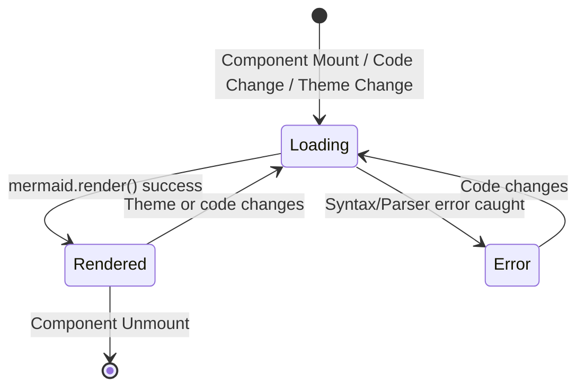

# Data Model & State Specifications: Mermaid Diagram Component

**Feature**: `001-markdown-mermaid-support`  
**Date**: 2026-10-13  

---

## 1. Entities & Types

### `MermaidBlockProps`
Properties received by the `MermaidBlock` component when rendered inside Markdown:

```typescript
export interface MermaidBlockProps {
  /** Raw Mermaid diagram code extracted from the Markdown code fence */
  code: string;
  /** Optional custom class name for the wrapper */
  className?: string;
}
```

### `DiagramRenderState`
Internal state model representing the lifecycle of rendering an SVG diagram:

```typescript
export type RenderStatus = "idle" | "loading" | "rendered" | "error";

export interface DiagramRenderState {
  status: RenderStatus;
  svgHtml: string | null;
  errorMessage: string | null;
}
```

### `DiagramViewMode`
Controls what view is currently active in the container:

```typescript
export type DiagramViewMode = "diagram" | "code";
```

### `ZoomPanState`
State for managing zoom and pan within the fullscreen lightbox modal:

```typescript
export interface ZoomPanState {
  scale: number;        // Range: 0.5 to 3.0, default: 1.0
  translateX: number;   // In pixels, default: 0
  translateY: number;   // In pixels, default: 0
}
```

---

## 2. State Transitions



1. **Mount / Prop Change**:
   - Status switches to `loading`.
   - Dynamic import loads `mermaid` if not already in memory.
   - Initialized with resolved theme (`dark` / `light`).
2. **Render Success**:
   - Status becomes `rendered`.
   - SVG content stored in `svgHtml`.
   - Errors cleared.
3. **Render Error**:
   - Status becomes `error`.
   - Error message captured.
   - UI falls back to showing error notification + syntax-highlighted code block.
