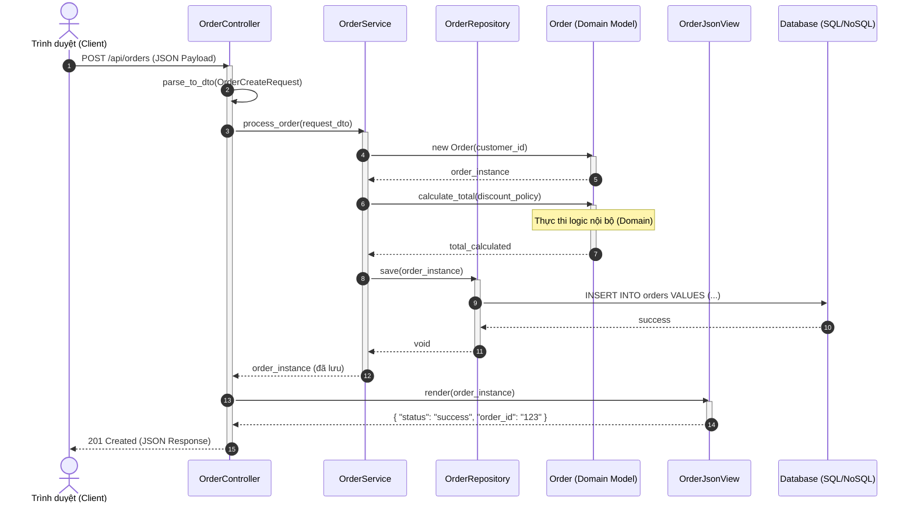

# Quickstart & Verification Guide: Mermaid Diagram Support

**Feature**: `001-markdown-mermaid-support`  
**Date**: 2026-10-13  

This guide provides test cases and verification scenarios to validate that Mermaid rendering works correctly across all user flows.

---

## Prerequisites

1. Dependency installed:
   ```bash
   pnpm add mermaid --filter frontend-quizz-app
   # or
   npm install mermaid --prefix apps/web
   ```
2. Next.js development server running:
   ```bash
   npm run dev --prefix apps/web
   ```

---

## Test Scenario 1: Standard Sequence Diagram (User's Example)

**Input Markdown**:

````markdown
# Kiểm tra biểu đồ Mermaid Sequence


````

**Expected Behavior**:
- The sequence diagram renders as a clean SVG graphic.
- Autonumber bubbles (1, 2, 3...) appear on arrows.
- Actor boxes and lifelines are neatly aligned.
- Internal horizontal scroll allows comfortable viewing if viewport width is narrow.

---

## Test Scenario 2: Fullscreen Lightbox & Zoom

**Steps**:
1. Hover or focus the diagram container.
2. Click the **Fullscreen / Expand** icon in the top-right toolbar.
3. Verify modal opens with darkened backdrop.
4. Test Zoom In (+), Zoom Out (-), and Reset buttons.
5. Press `Esc` or click the close button `X` to close.

**Expected Behavior**:
- Modal displays diagram at full scale without clipping.
- Zooming smoothly scales the SVG.
- Exiting returns the user to the exact scroll position in the markdown article.

---

## Test Scenario 3: Toggle Code & Copy Code

**Steps**:
1. Click the **Code** toggle button in the header toolbar.
2. Verify view switches to the raw Mermaid source text.
3. Click the **Copy** button.
4. Verify "Copied!" checkmark appears for 2 seconds and clipboard receives exact Mermaid text.
5. Click **Diagram** toggle to switch back to the rendered SVG.

---

## Test Scenario 4: Error Handling & Malformed Syntax

**Input Markdown**:

````markdown
```mermaid
sequenceDiagram
    Client ->> MissingArrow
    broken syntax %%%%
```
````

**Expected Behavior**:
- The component does NOT crash the page.
- Displays an alert banner: "Could not render diagram" with the error detail.
- Displays the raw syntax-highlighted code block below the alert with the Copy button still available.

---

## Test Scenario 5: Dark / Light Mode Switching

**Steps**:
1. Toggle the application theme between Dark and Light mode.
2. Verify diagrams immediately re-render using appropriate background, line, and text colors with sharp contrast.
