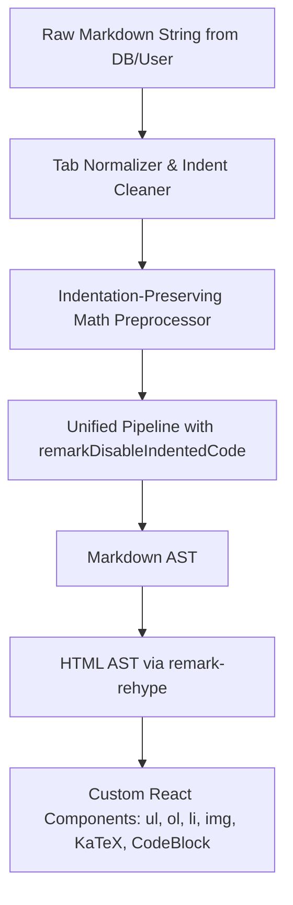
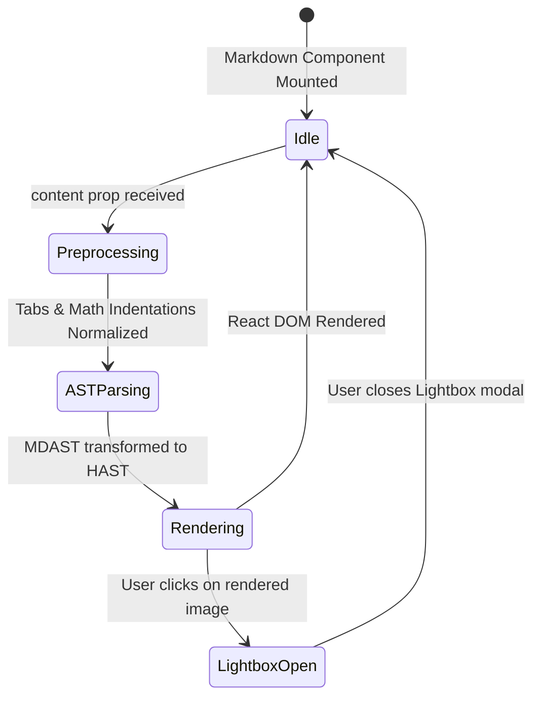

# Data Model: Markdown List Indentation & Nested Content Pipeline

**Branch**: `002-markdown-list-indent-fix` | **Date**: 2026-10-13 | **Spec**: [specs/002-markdown-list-indent-fix/spec.md](file:///Users/nguyenhuynh/Documents/projects/dut-ai-quiz/specs/002-markdown-list-indent-fix/spec.md)

## Pipeline Entities & Data Transformations

This feature operates purely on the frontend Markdown rendering pipeline. Below are the data structures, transformation phases, and component states.



---

### 1. Entity Definitions

#### `MarkdownProps` (Component Input)
The external interface contract for the `Markdown` component:
- `content: string` - The raw markdown text containing lists, math, images, code, or diagrams.
- `className?: string` - Optional CSS classes applied to the root wrapper.
- `highlightChunks?: string[]` - Optional array of strings to highlight for search / reference matches.

#### `ProcessedMarkdown` (Intermediate String State)
The transformed string output after passing through:
1. **Tab Normalization**: Converts `\t` characters to 4 spaces to ensure consistent column alignment across browsers.
2. **Indentation-Preserving Math Replacement**:
   - Detects `$$...$$` math blocks.
   - Captures any leading indentation on the line preceding `$$`.
   - Re-applies that exact indentation to the opening `$$`, inner formula lines, and closing `$$`.
   - Surrounds the block with spacing without stripping indentation.

#### `MicromarkExtensionConfig` (Parser Option)
The parser configuration injected via `remarkDisableIndentedCode`:
```ts
interface MicromarkDisableConfig {
  disable: {
    null: ["codeIndented"];
  };
}
```
- Disables the tokenizer for 4-space / tab-indented code blocks.
- Guarantees that only fenced code blocks (```` ``` ````) emit `code` AST nodes.

#### `AST Node Mapping` (AST to React Elements)

| AST Node | Condition | Target React Element | Render Styling |
|---|---|---|---|
| `list` | Ordered or unordered | `<ul>` or `<ol>` | Bulleted or numbered list container |
| `listItem` | Item in list | `<li>` | Nested list item with smooth line-height |
| `math` | Display math block | `<span className="katex-display">` | Centered KaTeX equation |
| `image` | `` | `` with zoom handler | Responsive rounded card + lightbox modal |
| `code` (inline) | Inline `` `code` `` | `<code>` | Pink pill badge with subtle slate background |
| `code` (fenced block) | Triple-backtick block | `<CodeBlock />` | Multi-line code container with copy button |

---

### 2. State Lifecycle


