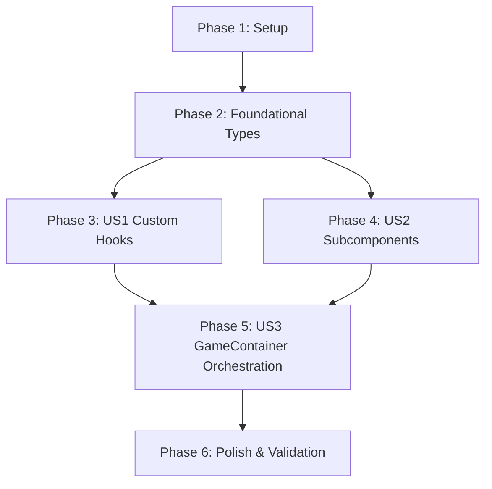

# Tasks: Refactor Game Container Architecture

**Input**: Design documents from `/specs/004-refactor-game-container/`
- Specification: [spec.md](file:///Users/nguyenhuynh/Documents/projects/dut-ai-quiz/specs/004-refactor-game-container/spec.md)
- Implementation Plan: [plan.md](file:///Users/nguyenhuynh/Documents/projects/dut-ai-quiz/specs/004-refactor-game-container/plan.md)
- Research & Decisions: [research.md](file:///Users/nguyenhuynh/Documents/projects/dut-ai-quiz/specs/004-refactor-game-container/research.md)
- State & Data Model: [data-model.md](file:///Users/nguyenhuynh/Documents/projects/dut-ai-quiz/specs/004-refactor-game-container/data-model.md)
- Hook Contracts: [contracts/game-hooks.md](file:///Users/nguyenhuynh/Documents/projects/dut-ai-quiz/specs/004-refactor-game-container/contracts/game-hooks.md)
- Component Contracts: [contracts/game-components.md](file:///Users/nguyenhuynh/Documents/projects/dut-ai-quiz/specs/004-refactor-game-container/contracts/game-components.md)
- Validation Scenarios: [quickstart.md](file:///Users/nguyenhuynh/Documents/projects/dut-ai-quiz/specs/004-refactor-game-container/quickstart.md)

**Tests**: Manual E2E validation against the 7 scenarios in [quickstart.md](file:///Users/nguyenhuynh/Documents/projects/dut-ai-quiz/specs/004-refactor-game-container/quickstart.md) + TypeScript strict compile check (`tsc --noEmit`). Automated unit tests were not explicitly requested.

**Organization**: Tasks are grouped by user story to enable independent implementation and testing of each story.

## Format: `- [ ] [ID] [P?] [Story] Description with file path`

- **[P]**: Can run in parallel (different files, no dependencies on incomplete tasks)
- **[Story]**: Which user story this task belongs to ([US1], [US2], [US3])
- Exact file paths are specified in every task description

---

## Phase 1: Setup (Shared Infrastructure)

**Purpose**: Project initialization and folder structure for extracted modules

- [x] T001 Create hooks directory structure at apps/web/features/game/hooks/
- [x] T002 [P] Verify and export shared game types and contracts needed by hooks and subcomponents in apps/web/features/game/types.ts

---

## Phase 2: Foundational (Blocking Prerequisites)

**Purpose**: Core types and shared constants that all hooks and components depend on

**⚠️ CRITICAL**: Must complete before user story implementation begins

- [x] T003 Ensure ItemType, BossStatus, and TurnState types are properly defined and re-exported in apps/web/features/game/types.ts

**Checkpoint**: Shared types ready - custom hooks and subcomponents can now be implemented.

---

## Phase 3: User Story 1 - Modular State & Logic Isolation (Priority: P1) 🎯 MVP

**Goal**: Extract game session lifecycle, timer countdowns, item actions, and turn progression into 4 focused custom hooks (`useGameSession`, `useGameTimer`, `useGameItems`, `useGameTurn`).

**Independent Test**: Each hook compiles cleanly with TypeScript (`tsc --noEmit`), conforms to contracts in `contracts/game-hooks.md`, and handles its localized state transitions without error.

### Implementation for User Story 1

- [x] T004 [P] [US1] Create useGameSession hook managing session initialization, state rehydration, and retry in apps/web/features/game/hooks/use-game-session.ts
- [x] T005 [P] [US1] Create useGameTimer hook managing countdown interval, freeze buff, and timeout trigger in apps/web/features/game/hooks/use-game-timer.ts
- [x] T006 [P] [US1] Create useGameItems hook managing 50-50, Freeze, Double Points, and Shield items in apps/web/features/game/hooks/use-game-items.ts
- [x] T007 [US1] Create useGameTurn hook managing answer selection, combat animations, and scoring in apps/web/features/game/hooks/use-game-turn.ts

**Checkpoint**: All 4 custom hooks implemented and independently typechecked against `contracts/game-hooks.md`.

---

## Phase 4: User Story 2 - Decomposed UI Component Hierarchy (Priority: P2)

**Goal**: Extract presentational UI sections (navigation bar, stage progress HUD, boss warning alert) into 3 focused, single-responsibility components.

**Independent Test**: Each component renders accurately per `contracts/game-components.md` with explicit, minimal props and zero type errors.

### Implementation for User Story 2

- [x] T008 [P] [US2] Create GameTopBar presentational component for back navigation and theme switch in apps/web/features/game/components/game-top-bar.tsx
- [x] T009 [P] [US2] Create GameHeaderHud presentational component for stage progress dots and neon score in apps/web/features/game/components/game-header-hud.tsx
- [x] T010 [P] [US2] Create GameAlertOverlay presentational component for animated boss warning banner in apps/web/features/game/components/game-alert-overlay.tsx

**Checkpoint**: All 3 presentational subcomponents implemented and ready for orchestration.

---

## Phase 5: User Story 3 - Seamless Gameplay Orchestration & Zero Functional Regression (Priority: P1)

**Goal**: Streamline `GameContainer` to under 200 lines by orchestrating the extracted hooks and subcomponents, while preserving 100% gameplay behavior, anti-cheat detection, and scroll layout.

**Independent Test**: Execute all 7 quickstart scenarios from `specs/004-refactor-game-container/quickstart.md` in the browser with zero regressions, verifying that line count is <= 200 lines.

### Implementation for User Story 3

- [x] T011 [US3] Refactor GameContainer in apps/web/features/game/components/game-container.tsx to orchestrate hooks and subcomponents under 200 lines
- [x] T012 [US3] Wire anti-cheat window blur listeners, penalty toasts, and health reduction inside apps/web/features/game/components/game-container.tsx
- [x] T013 [US3] Verify viewport auto-expansion, scrollbar styling, and smooth scroll down on question answer in apps/web/features/game/components/game-container.tsx

**Checkpoint**: `GameContainer` is under 200 lines, compiles cleanly, and orchestrates the complete match lifecycle without regressions.

---

## Phase 6: Polish & Cross-Cutting Concerns

**Purpose**: Typecheck verification, line count constraints, and end-to-end validation across all gameplay scenarios.

- [x] T014 Run TypeScript strict compile verification (tsc --noEmit) on apps/web
- [x] T015 Verify line count constraints (< 200 LOC for game-container.tsx, < 250 LOC for all newly created hooks/components)
- [x] T016 Validate all 7 gameplay scenarios from specs/004-refactor-game-container/quickstart.md in the browser

---

## Dependencies & Execution Order

### Phase Dependencies

- **Setup (Phase 1)**: No dependencies - can start immediately.
- **Foundational (Phase 2)**: Depends on Setup completion - BLOCKS User Story implementation.
- **User Story 1 (Phase 3)**: Depends on Foundational types (T003).
- **User Story 2 (Phase 4)**: Can start after Foundational types (T003). Runs in parallel with User Story 1 if desired.
- **User Story 3 (Phase 5)**: Depends on completion of User Story 1 (hooks) and User Story 2 (subcomponents) to assemble into `GameContainer`.
- **Polish (Phase 6)**: Depends on completion of User Story 3.



### Within Each Phase

- **US1 (Hooks)**: T004 (`useGameSession`), T005 (`useGameTimer`), and T006 (`useGameItems`) can be developed in parallel as they touch separate files. T007 (`useGameTurn`) integrates states from session, timer, and items.
- **US2 (Subcomponents)**: T008 (`GameTopBar`), T009 (`GameHeaderHud`), and T010 (`GameAlertOverlay`) touch distinct files and can run 100% in parallel.
- **US3 (Orchestration)**: Sequential execution within `game-container.tsx` (orchestration wiring → anti-cheat → scroll behavior).

### Parallel Opportunities

- **Setup**: T001 and T002 can run in parallel.
- **US1 Hooks**: T004 (`use-game-session.ts`), T005 (`use-game-timer.ts`), and T006 (`use-game-items.ts`) can run in parallel:
  ```bash
  # Parallel Hook Implementation:
  Task: "T004 [P] [US1] Create useGameSession hook in apps/web/features/game/hooks/use-game-session.ts"
  Task: "T005 [P] [US1] Create useGameTimer hook in apps/web/features/game/hooks/use-game-timer.ts"
  Task: "T006 [P] [US1] Create useGameItems hook in apps/web/features/game/hooks/use-game-items.ts"
  ```
- **US2 Subcomponents**: T008 (`game-top-bar.tsx`), T009 (`game-header-hud.tsx`), and T010 (`game-alert-overlay.tsx`) can run in parallel:
  ```bash
  # Parallel Component Implementation:
  Task: "T008 [P] [US2] Create GameTopBar in apps/web/features/game/components/game-top-bar.tsx"
  Task: "T009 [P] [US2] Create GameHeaderHud in apps/web/features/game/components/game-header-hud.tsx"
  Task: "T010 [P] [US2] Create GameAlertOverlay in apps/web/features/game/components/game-alert-overlay.tsx"
  ```

---

## Implementation Strategy

### MVP First (User Story 1 + Subcomponents)

1. Complete Phase 1 (Setup) and Phase 2 (Foundational types).
2. Complete Phase 3 (US1 Custom Hooks): `useGameSession`, `useGameTimer`, `useGameItems`, `useGameTurn`.
3. Complete Phase 4 (US2 Subcomponents): `GameTopBar`, `GameHeaderHud`, `GameAlertOverlay`.
4. Complete Phase 5 (US3 Orchestration): Refactor `GameContainer` down to < 200 lines.
5. **STOP and VALIDATE**: Run TypeScript typecheck (`tsc --noEmit`) and verify the 7 scenarios in [quickstart.md](file:///Users/nguyenhuynh/Documents/projects/dut-ai-quiz/specs/004-refactor-game-container/quickstart.md).

### Incremental Delivery Value

1. **Step 1 (Hooks)**: Isolates 500+ lines of mutable state, intervals, and mutations out of JSX into clean, testable TypeScript modules.
2. **Step 2 (Components)**: Isolates navigation, progress HUD, and warning modal out of `game-container.tsx`.
3. **Step 3 (Orchestrator)**: Shrinks `game-container.tsx` from 814 LOC to < 200 LOC, making the game architecture clean, maintainable, and robust against future changes.
