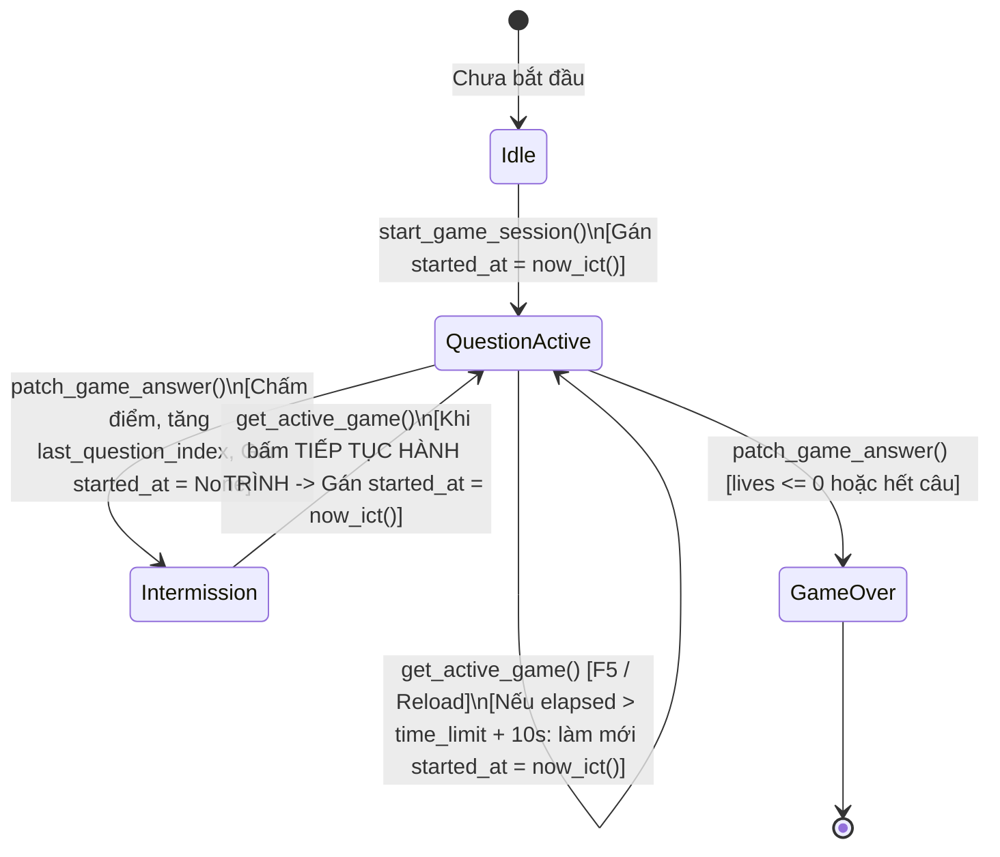

# Data Model & State Transitions: Game Answer Verification & Timer Synchronization

## 1. Gamification Snapshot Data Model

Cấu trúc lưu trữ trạng thái phiên chơi trong cột `snapshot` (JSONB) của bảng `game_sessions`:

```json
{
  "lesson_slug": "python-numpy-fundamentals",
  "questions": [
    {
      "id": "0dd26247-cef1-4c39-ae9a-8875f7db8e8d",
      "tier": 1,
      "content": "Khi mask là mảng bool, đoạn code sau in gì?...",
      "is_boss": false,
      "options": [
        { "id": "fad970cc", "text": "[-1, 0, 2]", "fixed": false },
        { "id": "e08ab9f2", "text": "[0, 0, 2]", "fixed": false },
        { "id": "35ad3336", "text": "[2]", "fixed": false },
        { "id": "d6d8a1bc", "text": "Lỗi vì mask khác shape", "fixed": false }
      ],
      "time_limit": 60,
      "time_response": 0.0
    }
  ],
  "answers": {
    "0dd26247-cef1-4c39-ae9a-8875f7db8e8d": "35ad3336"
  },
  "gamification": {
    "gold": 90,
    "lives": 3,
    "points": 40,
    "boss_hp": 0,
    "current_tier": 1,
    "last_question_index": 3,
    "current_question_started_at": "2026-10-24T17:10:00.000000+07:00",
    "total_time_response": 25.0
  }
}
```

### Chi tiết các thuộc tính cốt lõi của `GamificationState`:

| Thuộc tính | Kiểu dữ liệu | Mô tả |
|------------|--------------|-------|
| `current_question_started_at` | `str | None` | Mốc thời gian ISO 8601 của thời điểm câu hỏi hiện tại thực sự bắt đầu đếm giờ. Giá trị là `None` khi đang ở màn hình chuyển câu. |
| `last_question_index` | `int` | Chỉ số câu hỏi hiện tại (0-indexed). |
| `lives` | `int` | Số mạng hiện có của người chơi (khởi đầu = 3 hoặc 5 tùy thiết lập). |
| `points` | `int` | Điểm tích lũy trong trận đấu. |
| `gold` | `int` | Số vàng tích lũy được trong trận đấu. |
| `correct_count` | `int` | Số câu trả lời đúng. |

---

## 2. State Machine: Vòng đời của Bộ đếm thời gian (Timer Lifecycle)



### Các bước chuyển trạng thái chi tiết:

1. **Khởi tạo trận đấu (`start_game_session`)**:
   - `last_question_index = 0`
   - `current_question_started_at = now_ict().isoformat()`

2. **Nộp câu trả lời (`patch_game_answer`)**:
   - Tính toán tính đúng/sai: `is_correct = str(payload.option_id) == str(correct_opt_id)`.
   - Kiểm tra anti-cheat timeout:
     - Nếu `state.current_question_started_at` có giá trị:
       - `elapsed = (now_ict() - started_at).total_seconds()`
       - Nếu `elapsed > time_limit + 10.0`: `is_correct = False`, `payload.time_response = float(time_limit)`.
   - Lưu kết quả, tăng `last_question_index += 1`.
   - **Quan trọng**: `state.current_question_started_at = None` (Không bắt đầu tính giờ câu mới khi người dùng còn ở màn hình kết quả câu cũ).

3. **Bắt đầu câu hỏi tiếp theo (`get_active_game_session`)**:
   - Khi client gọi `GET /sessions/active`:
     - Nếu `state.current_question_started_at is None`:
       - `state.current_question_started_at = now_ict().isoformat()`
       - Lưu lại session vào database.
     - Nếu `state.current_question_started_at` đã tồn tại nhưng `(now_ict() - started_at).total_seconds() > current_q.time_limit + 10.0`:
       - Đây là phiên chơi dở dang được nạp lại sau thời gian dài.
       - Tự động làm mới: `state.current_question_started_at = now_ict().isoformat()` để người chơi làm câu hỏi hiện tại bình thường.
       - Lưu lại session vào database.
