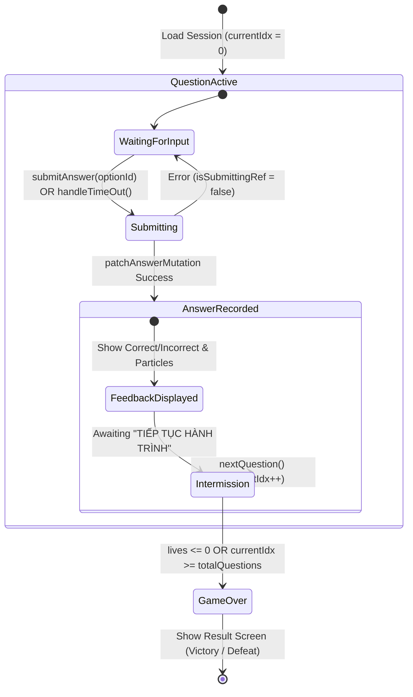

# Data Model & State Lifecycle: Arena Game Lifecycle and Turn Synchronization

**Feature**: `006-arena-lifecycle-sync`
**Date**: 2026-10-24

## 1. Entities & Value Objects

### GameSessionSnapshot (`apps/api/app/domain/value_objects/gamification.py`)
```python
@dataclass
class GameSessionSnapshot:
    lesson_slug: str = ""
    questions: list[QuestionSnapshot] = field(default_factory=list)
    answers: dict[str, str] = field(default_factory=dict) # q_id -> option_id
    gamification: GamificationState = field(default_factory=GamificationState)
```

- **`answers`**: Maps `question_id (str)` to `option_id (str)`. Serves as the source of truth for already answered questions.
- **`gamification.last_question_index`**: Tracks the 0-based pointer to the current question in `questions`.
- **`current_question()`**: Returns `questions[last_question_index]` if within bounds.

---

## 2. State Transition Machine



### Invariants:
1. `isSubmittingRef.current` MUST be `true` from the moment `submitAnswer` or `handleTimeOut` initiates until `nextQuestion` is invoked or submission fails.
2. If `str(payload.question_id) in snapshot.answers`, the backend treats the turn as already processed and returns the current gamification state idempotently.
3. Timer execution and item triggers MUST be disabled whenever `isAnswered == true` or `isSubmittingRef.current == true`.
