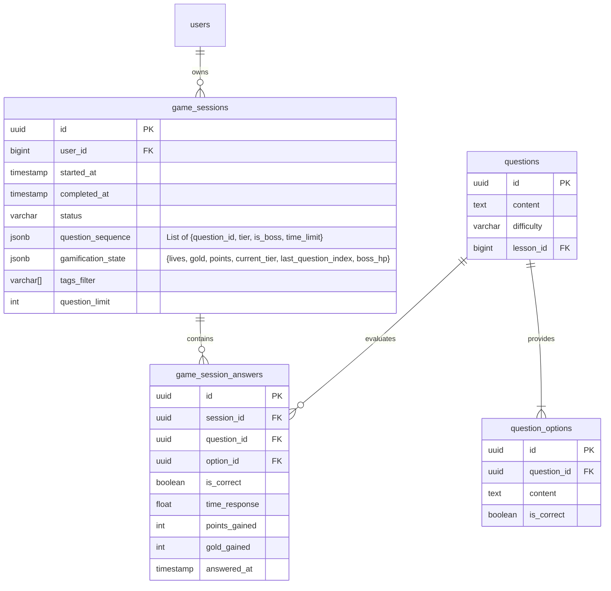

# Data Model: Game Session Storage & Append-Only Answer Log

**Branch**: `007-game-session-storage-refactor` | **Date**: 2026-10-25 | **Feature**: [spec.md](./spec.md)

This document formalizes the database schema, domain models, entity relationships, and state transitions for the refactored game session architecture.

---

## 1. Entity-Relationship Diagram



---

## 2. Database Schema (PostgreSQL DDL)

### A. New Table: `game_session_answers`

```sql
CREATE TABLE game_session_answers (
    id UUID PRIMARY KEY DEFAULT gen_random_uuid(),
    session_id UUID NOT NULL REFERENCES game_sessions(id) ON DELETE CASCADE,
    question_id UUID NOT NULL REFERENCES questions(id) ON DELETE RESTRICT,
    option_id UUID NOT NULL,
    is_correct BOOLEAN NOT NULL,
    time_response DOUBLE PRECISION NOT NULL DEFAULT 0.0,
    points_gained INTEGER NOT NULL DEFAULT 0,
    gold_gained INTEGER NOT NULL DEFAULT 0,
    answered_at TIMESTAMP WITH TIME ZONE NOT NULL DEFAULT (NOW() AT TIME ZONE 'Asia/Ho_Chi_Minh'),

    CONSTRAINT uq_game_session_answer_turn UNIQUE (session_id, question_id)
);

CREATE INDEX idx_game_session_answers_session_id ON game_session_answers(session_id);
CREATE INDEX idx_game_session_answers_question_id ON game_session_answers(question_id);
```

### B. Refactored Table: `game_sessions`

The existing `snapshot` JSONB column is streamlined:
- It no longer contains static `questions` (with their content and options) or an embedded mutable `answers` dictionary.
- It stores two compact structures:
  1. `question_sequence`: Array of lightweight descriptors:
     ```json
     [
       {"id": "67b938f2-...", "tier": 1, "is_boss": false, "time_limit": 60},
       {"id": "89c12345-...", "tier": 1, "is_boss": false, "time_limit": 60},
       {"id": "a1b2c3d4-...", "tier": 1, "is_boss": true, "time_limit": 30}
     ]
     ```
  2. `gamification_state`:
     ```json
     {
       "lives": 3,
       "gold": 0,
       "points": 0,
       "current_tier": 1,
       "last_question_index": 0,
       "boss_hp": 0,
       "shield_used_in_tier": {}
     }
     ```

---

## 3. Domain Entities & Value Objects

### `GameSessionEntity` (`app/domain/entities/game.py`)

```python
from dataclasses import dataclass
from datetime import datetime
from uuid import UUID
from app.domain.value_objects import GameSessionStatus
from app.domain.value_objects.gamification import GamificationState, QuestionMeta

@dataclass
class GameSessionEntity:
    id: UUID
    user_id: int
    started_at: datetime
    completed_at: datetime | None
    status: GameSessionStatus
    question_sequence: list[QuestionMeta]
    gamification: GamificationState
    tags_filter: list[str]
    question_limit: int

    @property
    def current_question_meta(self) -> QuestionMeta | None:
        idx = self.gamification.last_question_index
        if 0 <= idx < len(self.question_sequence):
            return self.question_sequence[idx]
        return None

    @property
    def is_all_answered(self) -> bool:
        return self.gamification.last_question_index >= len(self.question_sequence)

    @property
    def is_game_over(self) -> bool:
        return self.gamification.is_game_over(len(self.question_sequence))
```

### `GameSessionAnswerEntity` (`app/domain/entities/game_answer.py`)

```python
from dataclasses import dataclass
from datetime import datetime
from uuid import UUID

@dataclass(frozen=True)
class GameSessionAnswerEntity:
    id: UUID
    session_id: UUID
    question_id: UUID
    option_id: UUID
    is_correct: bool
    time_response: float
    points_gained: int
    gold_gained: int
    answered_at: datetime
```

---

## 4. State Invariants & Concurrency Guards

1. **Answer Turn Idempotency**:
   - `UNIQUE(session_id, question_id)` guarantees that exactly one answer can be registered for a question in a session.
   - Any concurrent request attempting to submit for the same turn triggers a database constraint error, protecting user lives and scores from double-decrement/increment.
2. **Session Progression Invariant**:
   - `last_question_index` advances if and only if a valid answer is inserted into `game_session_answers`.
   - The transaction modifying `game_sessions` and inserting into `game_session_answers` commits atomically.
3. **Game Completion Invariant**:
   - A session status changes to `COMPLETED` when `lives <= 0` (defeat) or when `last_question_index == len(question_sequence)` (victory).
   - Once `COMPLETED`, no further answers or item usages are permitted on that session.
