# Tasks: Game Session Storage Refactor & Append-Only Answer Log

**Input**: Design documents from `specs/007-game-session-storage-refactor/` (`spec.md`, `plan.md`, `research.md`, `data-model.md`, `contracts/game-api.yaml`, `quickstart.md`)

**Prerequisites**: `plan.md` (required), `spec.md` (required for user stories), `data-model.md`, `contracts/game-api.yaml`

**Tests**: Test-Driven Verification is mandatory per DUT-AI Quiz Constitution Principle IV. Test tasks are included and must pass before completion.

**Organization**: Tasks are grouped by user story to enable independent implementation and testing of each story.

---

## Format: `- [ ] [TaskID] [P?] [Story?] Description with file path`

- **[P]**: Can run in parallel (different files, no dependencies)
- **[Story]**: Which user story this task belongs to (e.g. `[US1]`, `[US2]`, `[US3]`)
- Every task includes exact file paths in its description.

---

## Phase 1: Setup (Shared Infrastructure)

**Purpose**: Verify development environment, create branch checkpoints, and prepare migration tooling.

- [x] T001 Verify database connectivity and Alembic environment configuration in `apps/api/alembic.ini` and `apps/api/alembic/env.py`
- [x] T002 [P] Verify `uv` virtual environment and pytest runner via `uv run pytest --version`

---

## Phase 2: Foundational (Blocking Prerequisites)

**Purpose**: Core database tables, domain entities, and repository interfaces that MUST be complete before any user story work begins.

**⚠️ CRITICAL**: Foundational phase must be completed before implementing user stories.

- [x] T003 Create `GameSessionAnswerEntity` domain model in `apps/api/app/domain/entities/game_answer.py` with fields: `id: UUID`, `session_id: UUID`, `question_id: UUID`, `option_id: UUID`, `is_correct: bool`, `time_response: float`, `points_gained: int`, `gold_gained: int`, `answered_at: datetime`
- [x] T004 [P] Refactor `GameSessionEntity` in `apps/api/app/domain/entities/game.py` to replace embedded questions snapshot with `question_sequence: list[QuestionMeta]` and `gamification: GamificationState`
- [x] T005 [P] Define `QuestionMeta` and update `GamificationState` value objects in `apps/api/app/domain/value_objects/gamification.py`
- [x] T006 Define `IGameSessionAnswerRepository` interface in `apps/api/app/domain/interfaces/repositories.py` with methods `add(answer: GameSessionAnswerEntity)`, `list_by_session(session_id: UUID)`, and `get_by_turn(session_id: UUID, question_id: UUID)`
- [x] T007 Create SQLModel persistence model `GameSessionAnswer` in `apps/api/app/infrastructure/persistence/models/game_answer.py` with `UniqueConstraint("session_id", "question_id", name="uq_game_session_answer_turn")`
- [x] T008 Update `GameSession` SQLModel in `apps/api/app/infrastructure/persistence/models/game.py` with `to_entity` and `from_entity` methods supporting lightweight `question_sequence` and `gamification_state`
- [x] T009 Create Alembic migration script in `apps/api/alembic/versions/` creating `game_session_answers` table with foreign keys, indexes, and unique constraint
- [x] T010 Add data backfill routine in the Alembic migration script to extract answers from legacy `game_sessions.snapshot` JSONB and populate `game_session_answers`
- [x] T011 Implement `GameSessionAnswerRepository` in `apps/api/app/infrastructure/persistence/repositories/game_answer.py` using SQLAlchemy async session
- [x] T012 Register `IGameSessionAnswerRepository` and `GameSessionAnswerRepository` in Dishka dependency injection container in `apps/api/app/ioc.py`

**Checkpoint**: Database schema and persistence foundation ready - user story implementation can begin.

---

## Phase 3: User Story 1 - Seamless Quiz Play with Instant Answer Recording (Priority: P1) 🎯 MVP

**Goal**: Participants start sessions, answer questions turn-by-turn with append-only logging, receive hydrated questions on-demand, and complete games without snapshot serialization.

**Independent Test**: Start a new game session, submit an answer for Question 0, verify exactly 1 row is appended to `game_session_answers`, verify `GamificationAnswerResultOut` returns the hydrated Question 1, and complete the game with score finalization.

### Tests for User Story 1

- [x] T013 [P] [US1] Create unit and use case test suite in `apps/api/test/test_game_storage_refactor.py` testing question sequence generation, turn answering, and append-only row creation

### Implementation for User Story 1

- [x] T014 [US1] Define Pydantic request/response schemas in `apps/api/app/presentation/schemas/game.py`: `GameSessionStartOut`, `GameOptionOut`, `GameQuestionSnapshotOut`, `GamificationStateOut`, `GamificationAnswerResultOut`
- [x] T015 [US1] Refactor `StartGameSessionUseCase` in `apps/api/app/application/use_cases/game/start_game_session.py` to store only `question_sequence` metadata and return Q0 hydrated from `IQuestionRepository`
- [x] T016 [US1] Refactor `PatchGameAnswerUseCase` in `apps/api/app/application/use_cases/game/patch_game_answer.py` to evaluate answer, insert a row into `game_session_answers`, update session gamification counters, and hydrate the next question
- [x] T017 [US1] Refactor `GetActiveGameSessionUseCase` in `apps/api/app/application/use_cases/game/get_active_game_session.py` to hydrate only the active question from `IQuestionRepository`
- [x] T018 [US1] Refactor `GetGameSessionUseCase` in `apps/api/app/application/use_cases/game/get_game_session.py` to hydrate the active question on demand
- [x] T019 [US1] Refactor `FinishGameSessionUseCase` in `apps/api/app/application/use_cases/game/finish_game_session.py` to aggregate total correct answers and final score from `game_session_answers`
- [x] T020 [US1] Clean `apps/api/app/presentation/api/routers/game.py`: remove `sanitize_game_snapshot`, remove all `import copy` calls, and attach explicit `response_model` to all session endpoints

**Checkpoint**: User Story 1 is fully functional. Sessions no longer serialize giant question snapshots, and answers are logged append-only.

---

## Phase 4: User Story 2 - Anti-Concurrency & Lost-Update Protection (Priority: P2)

**Goal**: Prevent race conditions between client auto-timeout submissions and manual clicks. Idempotent duplicate rejections via database constraints and row locking.

**Independent Test**: Fire two simultaneous `PATCH /sessions/{id}/answers` requests with identical `(session_id, question_id)` payload; verify that exactly one succeeds with HTTP 200, the second fails with HTTP 409/400 Conflict, and user lives are only decremented once.

### Tests for User Story 2

- [x] T021 [P] [US2] Add concurrency and idempotency tests in `apps/api/test/test_game_concurrency.py` verifying duplicate submission rejection and single-decrement invariant

### Implementation for User Story 2

- [x] T022 [US2] Add database integrity error interception in `PatchGameAnswerUseCase` in `apps/api/app/application/use_cases/game/patch_game_answer.py` mapping `IntegrityError` on `uq_game_session_answer_turn` to `DomainValidationException("Question already answered")`
- [x] T023 [US2] Add row-level locking (`with_for_update()`) in `GameSessionRepository.get(...)` in `apps/api/app/infrastructure/persistence/repositories/game.py` during answer patch and item usage
- [x] T024 [US2] Add HTTP 409 Conflict exception handler for turn duplicate submissions in `apps/api/app/presentation/api/routers/game.py`

**Checkpoint**: Concurrency protection is active. Race conditions between timeout and click cannot produce lost updates or double deductions.

---

## Phase 5: User Story 3 - Granular Match Review & Educational Analytics (Priority: P3)

**Goal**: Provide a detailed post-game review endpoint (`GET /sessions/{id}/review`) returning the chronological timeline of answered questions, choices, correctness, time spent, and explanations.

**Independent Test**: Query `GET /api/v1/game/sessions/{session_id}/review` for a completed game; verify it returns an ordered list of all attempted questions with student answers, correct answers, explanations, and response durations.

### Tests for User Story 3

- [x] T025 [P] [US3] Add review endpoint tests in `apps/api/test/test_game_review.py` verifying complete timeline retrieval for finished sessions

### Implementation for User Story 3

- [x] T026 [P] [US3] Define Pydantic review schemas in `apps/api/app/presentation/schemas/game.py`: `GameSessionReviewItemOut` and `GameSessionReviewOut`
- [x] T027 [US3] Implement `GetGameSessionReviewUseCase` in `apps/api/app/application/use_cases/game/get_game_session_review.py` querying `game_session_answers` and hydrating question details with explanations
- [x] T028 [US3] Register `GetGameSessionReviewUseCase` in Dishka DI container in `apps/api/app/ioc.py`
- [x] T029 [US3] Add endpoint `GET /sessions/{session_id}/review` with `response_model=GameSessionReviewOut` in `apps/api/app/presentation/api/routers/game.py`

**Checkpoint**: Completed sessions provide granular review analytics.

---

## Phase 6: Polish & Frontend Synergy

**Purpose**: Synchronize OpenAPI contracts, remove obsolete fallback code in the Next.js frontend, and eliminate all deprecated backward-compatibility shims.

- [x] T030 Run `make generate-api` to regenerate `apps/web/types/api.generated.d.ts` from the updated FastAPI OpenAPI contract
- [x] T031 Update domain types in `apps/web/features/game/types.ts` to map new `GameSessionStartOut` and `GameSessionReviewOut` schemas
- [x] T032 Remove obsolete fallback re-stitching loop (`refetchActiveSession()` with `prevQuestions[i] || q`) in `apps/web/features/game/hooks/use-game-turn.ts`
- [x] T033 Update `apps/web/features/game/hooks/use-game-session.ts` to consume the streamlined `GameSessionStartOut` structure
- [x] T034 [P] Add React Query hook `useGameSessionReview(sessionId: string)` in `apps/web/features/game/queries.ts`
- [x] T035 Verify frontend type integrity via `cd apps/web && npm run type-check` (Must pass with 0 errors)
- [x] T036 Run full backend test suite via `uv run pytest test/test_game_storage_refactor.py test/test_game_unit.py test/test_gamification_state.py -v`
- [x] T037 Run full pre-commit verification suite via `make check`

---

## Dependencies & Execution Order

```mermaid
graph TD
    subgraph Foundational
        T001 --> T003
        T002 --> T003
        T003 --> T004
        T004 --> T006
        T005 --> T006
        T006 --> T007
        T007 --> T008
        T008 --> T009
        T009 --> T010
        T010 --> T011
        T011 --> T012
    end

    subgraph US1_MVP [Phase 3: US1 - Core Play MVP]
        T012 --> T013
        T013 --> T014
        T014 --> T015
        T015 --> T016
        T016 --> T017
        T017 --> T018
        T018 --> T019
        T019 --> T020
    end

    subgraph US2_Concurrency [Phase 4: US2 - Concurrency Protection]
        T020 --> T021
        T021 --> T022
        T022 --> T023
        T023 --> T024
    end

    subgraph US3_Review [Phase 5: US3 - Match Review Analytics]
        T024 --> T025
        T025 --> T026
        T026 --> T027
        T027 --> T028
        T028 --> T029
    end

    subgraph Polish [Phase 6: Polish & Frontend Synergy]
        T029 --> T030
        T030 --> T031
        T031 --> T032
        T032 --> T033
        T033 --> T034
        T034 --> T035
        T035 --> T036
        T036 --> T037
    end
```

---

## Parallel Execution Opportunities

- **Phase 2 (Foundational)**:
  - `T004` (Refactor `GameSessionEntity`) and `T005` (Define `QuestionMeta`) can run in parallel.
  - `T007` (SQLModel `GameSessionAnswer`) and `T008` (SQLModel `GameSession`) can run in parallel.
- **Phase 3 (US1)**:
  - `T013` (Test suite skeleton) can be authored while `T014` (Pydantic schemas) is drafted.
- **Phase 5 (US3)**:
  - `T025` (Review tests) and `T026` (Review schemas) can run in parallel.
- **Phase 6 (Polish)**:
  - `T032` (Clean turn hook), `T033` (Update session hook), and `T034` (Review query hook) can be edited concurrently across different files.

---

## Implementation Strategy: MVP First

1. **Deliver MVP (US1)**: Complete Phases 1, 2, and 3. At this stage, the core game loop runs with 100% append-only logging, 90% reduced DB writes, zero giant snapshot serialization, and no `sanitize_game_snapshot` overhead.
2. **Harden Concurrency (US2)**: Complete Phase 4 to lock down idempotency and race condition protection.
3. **Add Value-Add Feature (US3)**: Complete Phase 5 to deliver the match review endpoint.
4. **Clean Frontend & Ship (Polish)**: Complete Phase 6, re-generate types, eliminate client-side workarounds, and run `make check`.
