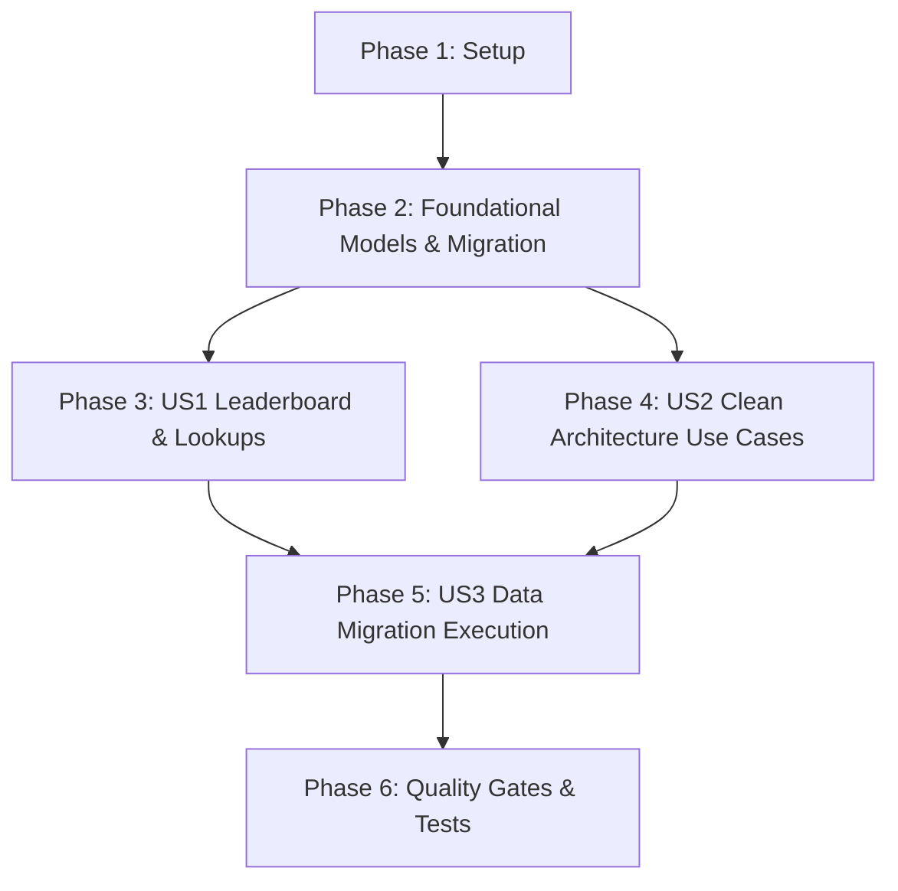

# Tasks: Game Session Schema Normalization & Query Optimization

**Input**: Design documents from `/specs/008-game-session-schema-normalization/`  
**Prerequisites**: [plan.md](file:///Users/nguyenhuynh/Documents/projects/dut-ai-quiz/specs/008-game-session-schema-normalization/plan.md), [spec.md](file:///Users/nguyenhuynh/Documents/projects/dut-ai-quiz/specs/008-game-session-schema-normalization/spec.md), [research.md](file:///Users/nguyenhuynh/Documents/projects/dut-ai-quiz/specs/008-game-session-schema-normalization/research.md), [data-model.md](file:///Users/nguyenhuynh/Documents/projects/dut-ai-quiz/specs/008-game-session-schema-normalization/data-model.md), [contracts/game-session.md](file:///Users/nguyenhuynh/Documents/projects/dut-ai-quiz/specs/008-game-session-schema-normalization/contracts/game-session.md)  
**Organization**: Tasks are grouped by user story to enable independent implementation and testing of each story.

---

## Format: `- [ ] [TaskID] [P?] [Story?] Description with file path`

- **[P]**: Can run in parallel (different files, no dependencies)
- **[Story]**: Which user story this task belongs to (e.g., US1, US2, US3)

---

## Phase 1: Setup & Pre-Migration Preparation

**Purpose**: Prepare migration scaffolding and test harness for schema normalization

- [x] T001 Create Alembic revision skeleton `apps/api/alembic/versions/f01a2b3c4d5e_normalize_game_sessions_schema.py`
- [x] T002 [P] Inspect existing game test suites and baseline tests in `apps/api/test/test_game_storage_refactor.py`

---

## Phase 2: Foundational (Database Migration & Model Normalization)

**Purpose**: Core schema transformation and model definitions that MUST complete before user story queries can run

- [x] T003 Implement two-step migration and backfill logic (add new columns, backfill from `tags_filter` and `snapshot`, drop legacy columns, create indexes) in `apps/api/alembic/versions/f01a2b3c4d5e_normalize_game_sessions_schema.py`
- [x] T004 Apply migration `alembic upgrade head` to dev database and verify columns in `apps/api`
- [x] T005 [P] Update SQLModel `GameSession` in `apps/api/app/infrastructure/persistence/models/game.py` with normalized fields (`lesson_slug`, `final_score`, `gold_earned`, `total_time_response`, `attempt_count`, `current_tier`, `question_sequence`, `gamification_state`)
- [x] T006 [P] Update domain entity `GameSessionEntity` in `apps/api/app/domain/entities/game.py` to expose typed normalized attributes and remove `tags_filter` / `snapshot_state` legacy properties

---

## Phase 3: User Story 1 - Instant Leaderboard & High-Performance Match Queries (Priority: P1)

**Goal**: Execute leaderboard rankings and session lookups using B-Tree index scan on native columns with zero in-memory JSON text casting.  
**Independent Test**: Running `get_leaderboard_by_lesson` on database returns ranked rows in < 15ms via `idx_game_sessions_leaderboard`.

- [x] T007 [US1] Update `get_leaderboard_by_lesson` query in `apps/api/app/infrastructure/repositories/game_sessions.py` to filter by `GameSession.lesson_slug == lesson_slug` and order by `final_score.desc(), gold_earned.desc(), total_time_response.asc(), attempt_count.asc()`
- [x] T008 [P] [US1] Update `get_active_by_lesson` in `apps/api/app/infrastructure/repositories/game_sessions.py` to filter by `GameSession.lesson_slug == lesson_slug`
- [x] T009 [P] [US1] Update `count_completed_by_lesson` in `apps/api/app/infrastructure/repositories/game_sessions.py` to filter by `GameSession.lesson_slug == lesson_slug`
- [x] T010 [US1] Verify composite index `idx_game_sessions_user_lesson_status` and leaderboard index in `apps/api/app/infrastructure/repositories/game_sessions.py`
- [x] T011 [US1] Update leaderboard unit tests in `apps/api/test/test_game_leaderboard.py` to validate query execution against normalized entity models

---

## Phase 4: User Story 2 - Clean Architecture & Native Column Separation (Priority: P2)

**Goal**: Update all game loop use cases, services, and routers to read/write normalized attributes directly without `tags_filter` or `snapshot`.  
**Independent Test**: Starting, answering, and finishing a game session updates native numeric columns and JSONB structures cleanly.

- [x] T012 [US2] Update `start_game_session.py` use case in `apps/api/app/application/use_cases/game/start_game_session.py` to populate `lesson_slug=payload.lesson_slug` and `question_sequence`
- [x] T013 [US2] Update `patch_game_answer.py` use case in `apps/api/app/application/use_cases/game/patch_game_answer.py` to update native `final_score`, `gold_earned`, `total_time_response`, and `gamification_state`
- [x] T014 [P] [US2] Update `finish_game_session.py` use case in `apps/api/app/application/use_cases/game/finish_game_session.py` to read `session.lesson_slug`
- [x] T015 [P] [US2] Update `get_game_history_summary.py` use case in `apps/api/app/application/use_cases/game/get_game_history_summary.py` to read `s.lesson_slug`
- [x] T016 [US2] Update `game_hydration.py` service in `apps/api/app/application/services/game_hydration.py` to use `session.lesson_slug` and `session.question_sequence`
- [x] T017 [US2] Update router DTO builders in `apps/api/app/presentation/api/routers/game.py` to map `lesson_slug` and provide backward-compatible `tags_filter=[row.lesson_slug]`
- [x] T018 [US2] Update session repository `save` and `add` methods in `apps/api/app/infrastructure/repositories/game_sessions.py` to persist normalized columns

---

## Phase 5: User Story 3 - Zero-Downtime Data Migration & Integrity Verification (Priority: P3)

**Goal**: Execute and verify migration across database environments with zero data loss.  
**Independent Test**: Running verification query on migrated databases confirms 100% of rows have valid `lesson_slug` and extracted scores matching historical snapshots.

- [x] T019 [US3] Run migration `alembic upgrade head` on `quizdb_dev` and verify all 776 rows have populated `lesson_slug` and `final_score`
- [x] T020 [US3] Run migration `alembic upgrade head` on `quizdb_prod` and verify all 844 rows have populated `lesson_slug` and `final_score`
- [x] T021 [US3] Verify `tags_filter` and `snapshot` columns are dropped and cannot be queried

---

## Phase 6: Polish & Cross-Cutting Quality Gates

**Purpose**: Test suite alignment, pre-commit quality checks, and clean code validation

- [x] T022 Update all existing test fixtures in `apps/api/test/test_game_unit.py`, `apps/api/test/test_game_review.py`, `apps/api/test/test_game_concurrency.py`, `apps/api/test/test_game_storage_refactor.py`, `apps/api/test/test_game_timer_verification.py`, `apps/api/test/test_game_resume.py` to use `lesson_slug`
- [x] T023 Run full pytest suite across all test files (`uv run pytest apps/api/test/test_game_*.py -v`)
- [x] T024 Run `make check` to ensure Ruff linter & formatter, ESLint, and TypeScript type-check pass with zero errors

---

## Dependencies & Execution Order

### Parallel Execution Opportunities
- **Within Phase 2**: T005 (`GameSession` model) and T006 (`GameSessionEntity`) can be implemented in parallel.
- **Within Phase 3**: T008 (`get_active_by_lesson`) and T009 (`count_completed_by_lesson`) can be updated in parallel.
- **Within Phase 4**: T014 (`finish_game_session`), T015 (`get_game_history_summary`), and T016 (`game_hydration`) can be updated in parallel.
- **Within Phase 6**: Unit test fixture updates can be parallelized across different test files.

---

## Implementation Strategy: MVP First (Incremental Delivery)
1. **MVP Scope**: Complete Phase 1 and Phase 2. This creates the normalized database schema and entity models.
2. **Increment 1 (US1)**: Optimize `GameSessionRepository` queries to leverage the new native columns and indexes for instant leaderboard lookups.
3. **Increment 2 (US2)**: Refactor all game use cases and router mappings to interact directly with `lesson_slug` and scoring fields.
4. **Increment 3 (US3 & Polish)**: Execute database migrations on both environments, verify data integrity, update test fixtures, and pass all `make check` quality gates.
