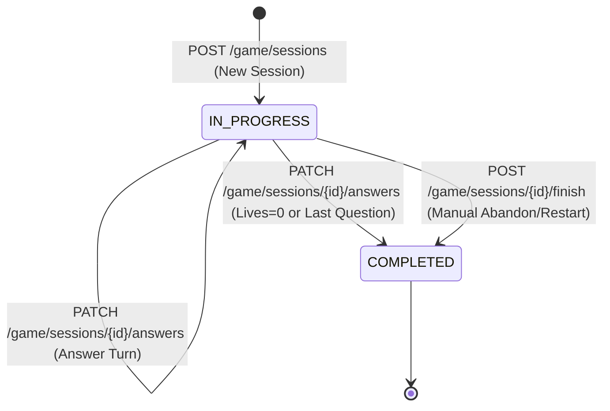

# Data Model: Clean Game Session API Contract & Dead Code Elimination

**Feature Branch**: `009-clean-game-contract-dead-code`  
**Date**: 2026-10-25  
**Spec**: [spec.md](spec.md)

---

## 1. Core Domain Entity: `GameSessionEntity`

The canonical domain model representing an active or completed quiz match.

### Class Definition

```python
@dataclass
class GameSessionEntity:
    id: UUID
    user_id: int
    started_at: datetime
    completed_at: datetime | None = None
    status: GameSessionStatus = GameSessionStatus.IN_PROGRESS
    question_sequence: list[QuestionMeta] = field(default_factory=list)
    gamification: GamificationState = field(default_factory=GamificationState)
    lesson_slug: str = ""
    question_limit: int = 10
```

### Invariants & Business Logic
- `lesson_slug`: Canonical non-empty string identifier for the lesson.
- `status`: Transition follows `IN_PROGRESS` → `COMPLETED`. Cannot transition back from `COMPLETED` to `IN_PROGRESS`.
- `question_sequence`: Read-only ordered roadmap of questions (`QuestionMeta`: `id`, `tier`, `is_boss`, `time_limit`). Never contains question text or options.
- `gamification`: Holds mutable turn state (`lives`, `gold`, `points`, `current_tier`, `last_question_index`, `boss_hp`, `shield_used_in_tier`, `total_time_response`, `correct_count`, `final_score`, `attempt_count`).
- **Removed Dead Code**: All legacy properties (`tags_filter`, `snapshot`) and backward-compatibility constructor shims are completely removed.

---

## 2. Presentation Schemas (Pydantic DTOs)

### 2.1. Unified `GameSessionOut`

Replaces both `GameSessionStartOut` and `GameSessionDetailOut`.

```python
class GameSessionOut(BaseModel):
    id: UUID
    user_id: int
    lesson_slug: str
    status: str
    started_at: datetime
    completed_at: datetime | None = None
    question_limit: int = 10
    current_question_index: int = 0
    current_question: GameQuestionSnapshotOut | None = None
    gamification: GamificationStateOut = Field(default_factory=GamificationStateOut)

    model_config = {"from_attributes": True}
```

### 2.2. Turn Resolution `GamificationAnswerResultOut`

Cleaned of legacy `snapshot` field.

```python
class GamificationAnswerResultOut(BaseModel):
    is_correct: bool
    points_gained: int
    coins_gained: int
    updated_gamification: GamificationStateOut
    is_game_over: bool
    correct_option_id: str | None = None
    next_question: GameQuestionSnapshotOut | None = None

    model_config = {"from_attributes": True}
```

### 2.3. Hydrated Question Schemas

```python
class GameQuestionOptionOut(BaseModel):
    id: str
    text: str


class GameQuestionSnapshotOut(BaseModel):
    id: str
    content: str
    options: list[GameQuestionOptionOut] = Field(default_factory=list)
    time_limit: int = 60
    time_response: float = 0.0
    tier: int = 1
    is_boss: bool = False

    model_config = {"from_attributes": True}
```

### 2.4. Gamification State

```python
class GamificationStateOut(BaseModel):
    lives: int = 3
    gold: int = 0
    points: int = 0
    current_tier: int = 1
    last_question_index: int = 0
    boss_hp: int = 0
    shield_used_in_tier: dict[str, bool] = Field(default_factory=dict)
    total_time_response: float = 0.0
    correct_count: int = 0
    final_score: float = 0.0
    attempt_count: int = 1

    model_config = {"from_attributes": True}
```

---

## 3. Hydration & Mapping Rules (`GameHydrationService`)

`GameHydrationService` becomes the single authority for translating domain entities into presentation schemas:

1. **`to_session_out(session: GameSessionEntity, include_current_question: bool = True) -> GameSessionOut`**:
   - Computes `current_idx = session.gamification.last_question_index`.
   - If `include_current_question` and `current_idx < len(session.question_sequence)` and `session.status == IN_PROGRESS`:
     - Hydrates `session.question_sequence[current_idx]` with text and options from `question_repo`.
   - Maps `GamificationState` directly to `GamificationStateOut`.
   - Returns flat `GameSessionOut`.

2. **`hydrate_question_snapshot(meta: QuestionMeta) -> GameQuestionSnapshotOut`**:
   - Queries `question_repo` by UUID.
   - Converts options to `GameQuestionOptionOut(id=..., text=...)`.
   - Returns `GameQuestionSnapshotOut`.

3. **`to_history_out(session: GameSessionEntity) -> GameSessionOut`**:
   - Converts completed session to `GameSessionOut` with `current_question = None` and zero additional N+1 queries.

---

## 4. State Transitions


