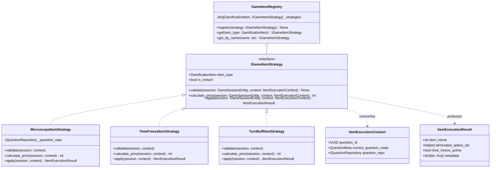

# Data Model & Interface Architecture: Extensible Game Item System

**Feature**: `010-game-item-system`  
**Date**: 2026-10-25  

## 1. Class Diagram & Architecture Overview



---

## 2. Core Entities & Value Objects

### 2.1. `IGameItemStrategy` (Interface)

- **Location**: `app/domain/interfaces/game_items.py`
- **Purpose**: Contract for every item in the game.
- **Attributes**:
  - `item_type: GamificationItem`: Corresponding item enum value.
  - `is_instant: bool`: True if usable mid-turn via `/use-item`; False if turn-based buff.
- **Methods**:
  - `validate(session: GameSessionEntity, context: ItemExecutionContext) -> None`: Validates preconditions (e.g., question ID match, session state). Raises `DomainValidationException` on invalid state.
  - `calculate_price(session: GameSessionEntity, context: ItemExecutionContext) -> int`: Returns gold cost, applying any boss or tier multipliers.
  - `async apply(session: GameSessionEntity, context: ItemExecutionContext) -> ItemExecutionResult`: Mutates session/gamification state and returns outcome result.

### 2.2. `ItemExecutionContext` (Value Object)

- **Location**: `app/domain/value_objects/game_items.py`
- **Purpose**: Immutable parameter context passed into strategies during execution.
- **Fields**:
  - `question_id: UUID`: ID of the target question submitted in the request.
  - `current_question_meta: QuestionMeta`: Metadata of active question (tier, is_boss, time_limit).
  - `question_repo: IQuestionRepository`: Repository dependency for option queries.

### 2.3. `ItemExecutionResult` (Value Object)

- **Location**: `app/domain/value_objects/game_items.py`
- **Purpose**: Encapsulates outcome generated by an item execution.
- **Fields**:
  - `item_name: str`: Serialized name of the item.
  - `eliminated_option_ids: list[str]`: IDs of options removed from UI (default: empty list).
  - `time_freeze_active: bool`: Whether time freeze was activated (default: False).
  - `metadata: dict[str, Any]`: Optional extensible dictionary for future item outcomes (e.g. hints, bonus tokens).

### 2.4. `GameItemRegistry` (Service)

- **Location**: `app/application/services/game_items/registry.py`
- **Purpose**: Central lookup and registry mapping enum types to strategies.
- **Methods**:
  - `register(strategy: IGameItemStrategy) -> None`: Adds a strategy to the registry.
  - `get(item_type: GamificationItem) -> IGameItemStrategy`: Retrieves strategy; raises `DomainValidationException` if missing.
  - `get_by_name(name: str) -> IGameItemStrategy`: Normalizes item name string to enum and retrieves strategy.

---

## 3. Concrete Strategy Specifications

| Strategy Class | Target Item | Base Price | Boss Multiplier | Key Behavior |
| :--- | :--- | :---: | :---: | :--- |
| `MicroscopeItemStrategy` | `MICROSCOPE` | 50 | 2x (100) | Queries options from repository, samples 2 incorrect options, returns their IDs. |
| `TimeFreezeItemStrategy` | `TIME_FREEZE` | 40 | 2x (80) | Sets `time_freeze_active = True`. |
| `TurnBuffItemStrategy` | `DOUBLE_POINTS`, `SHIELD` | 100, 80 | 2x (200, 160) | Declares `is_instant = False`. Raises `DomainValidationException` on instant use attempt. |

---

## 4. Refactored Use Case Flow (`UseItemGameUseCase`)

```python
class UseItemGameUseCase:
    def __init__(
        self,
        ps_repo: IGameSessionRepository,
        question_repo: IQuestionRepository,
        item_registry: GameItemRegistry,
    ):
        self._ps_repo = ps_repo
        self._question_repo = question_repo
        self._item_registry = item_registry

    async def execute(
        self, session_id: UUID, user_id: int, payload: GamificationUseItemIn
    ) -> GamificationUseItemResultOut:
        session = await self._ps_repo.get(session_id, for_update=True)
        if not session or session.user_id != user_id:
            raise EntityNotFoundException("Game session not found")

        strategy = self._item_registry.get_by_name(payload.item_name)
        context = ItemExecutionContext(
            question_id=payload.question_id,
            current_question_meta=session.current_question_meta,
            question_repo=self._question_repo,
        )

        strategy.validate(session, context)
        price = strategy.calculate_price(session, context)
        if not session.gamification.has_enough_gold(price):
            raise InsufficientResourceException("Not enough gold to use this item")

        session.gamification.deduct_gold(price)
        result = await strategy.apply(session, context)
        await self._ps_repo.save(session)

        return GamificationUseItemResultOut(
            item_name=result.item_name,
            eliminated_option_ids=result.eliminated_option_ids,
            time_freeze_active=result.time_freeze_active,
            updated_gamification=GamificationStateOut.model_validate(session.gamification.to_dict()),
        )
```
