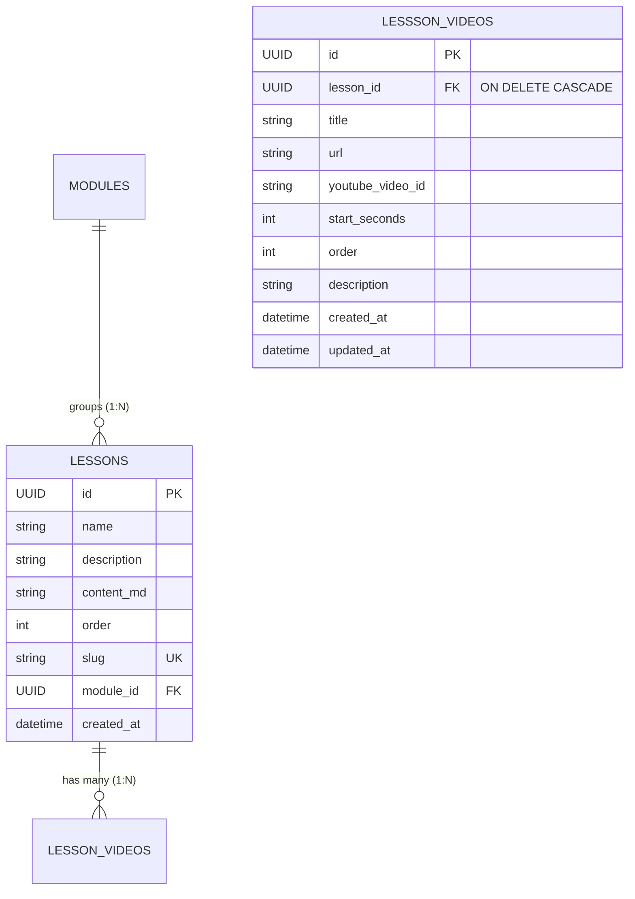

# Data Model: Lesson YouTube Reference Videos

**Feature**: `011-lesson-youtube-videos`  
**Date**: 2026-11-01  
**Status**: Completed  

## 1. Entity Relationship Diagram



## 2. Persistence Model (SQLModel / SQLAlchemy)

### Table: `lesson_videos`

| Column | Type | Nullable | Default | Description |
|---|---|---|---|---|
| `id` | `UUID` | No | `uuid4()` | Primary key |
| `lesson_id` | `UUID` | No | None | Foreign key to `lessons.id` (Indexed, `ON DELETE CASCADE`) |
| `title` | `VARCHAR(255)` | No | None | Human-readable title of the reference video |
| `url` | `TEXT` | No | None | Full raw YouTube URL input by educator |
| `youtube_video_id` | `VARCHAR(32)` | No | None | Extracted 11-char YouTube ID (Indexed) |
| `start_seconds` | `INTEGER` | No | `0` | Normalized start offset in seconds |
| `order` | `INTEGER` | No | `0` | Display sequence within the lesson playlist |
| `description` | `TEXT` | No | `""` | Optional markdown or text notes for the video |
| `created_at` | `TIMESTAMP` | No | `now_ict` | Record creation timestamp |
| `updated_at` | `TIMESTAMP` | No | `now_ict` | Record last update timestamp |

## 3. Domain Entity (Clean Architecture)

### `LessonVideoEntity` (`app/domain/entities/lesson_video.py`)

```python
from dataclasses import dataclass
from datetime import datetime
from uuid import UUID


@dataclass
class LessonVideoEntity:
    """Domain entity representing a YouTube reference video linked to a lesson."""

    id: UUID
    lesson_id: UUID
    title: str
    url: str
    youtube_video_id: str
    start_seconds: int = 0
    order: int = 0
    description: str = ""
    created_at: datetime | None = None
    updated_at: datetime | None = None
```

## 4. Pydantic Schemas & API Contracts

### Presentation Schemas (`app/presentation/schemas/lessons.py`)

```python
from datetime import datetime
from uuid import UUID
from pydantic import BaseModel, Field, HttpUrl


class LessonVideoCreate(BaseModel):
    """Payload to create or add a reference video."""

    title: str = Field(..., min_length=1, max_length=255)
    url: str = Field(..., description="Valid YouTube video URL")
    description: str = Field(default="", max_length=1000)
    order: int = Field(default=0, ge=0)


class LessonVideoUpdate(BaseModel):
    """Payload to update an existing reference video."""

    title: str | None = Field(default=None, min_length=1, max_length=255)
    url: str | None = None
    description: str | None = None
    order: int | None = None


class LessonVideoOut(BaseModel):
    """Response schema for a lesson video."""

    id: UUID
    lesson_id: UUID
    title: str
    url: str
    youtube_video_id: str
    start_seconds: int
    order: int
    description: str
    created_at: datetime
    updated_at: datetime

    model_config = {"from_attributes": True}


class LessonVideoBatchSync(BaseModel):
    """Payload for syncing the entire video playlist of a lesson."""

    videos: list[LessonVideoCreate]
```

## 5. Frontend Types & Zod Schemas (`apps/web/features/lessons/types.ts`)

```typescript
import { z } from "zod";

export const LessonVideoSchema = z.object({
  id: z.string(),
  lesson_id: z.string(),
  title: z.string().min(1, "Tiêu đề video không được để trống"),
  url: z.string().url("URL không hợp lệ"),
  youtube_video_id: z.string(),
  start_seconds: z.number().default(0),
  order: z.number().default(0),
  description: z.string().optional().default(""),
  created_at: z.string().optional(),
  updated_at: z.string().optional(),
});

export type LessonVideo = z.infer<typeof LessonVideoSchema>;

export const LessonVideoInputSchema = z.object({
  title: z.string().min(1, "Tiêu đề video không được để trống"),
  url: z.string().min(1, "Vui lòng nhập đường link YouTube"),
  description: z.string().optional().default(""),
  order: z.number().default(0),
});

export type LessonVideoInput = z.infer<typeof LessonVideoInputSchema>;
```

## 6. Validation Rules & Invariants

1. **YouTube URL Validity**:
   - Must match known YouTube patterns: `youtube.com`, `youtu.be`, or `youtube-nocookie.com`.
   - Must contain a valid 11-character video ID.
   - Non-matching URLs fail with domain validation error: `"Đường dẫn video phải là link YouTube hợp lệ"`.
2. **Timestamp Non-negativity**:
   - `start_seconds >= 0`. Negative seconds are normalized to 0.
3. **Cascade Deletion**:
   - When a `lessons` record is deleted, all corresponding `lesson_videos` records are dropped by PostgreSQL foreign key constraint `ON DELETE CASCADE`.
4. **Order Sequence**:
   - Videos are retrieved with `ORDER BY order ASC, created_at ASC`.
