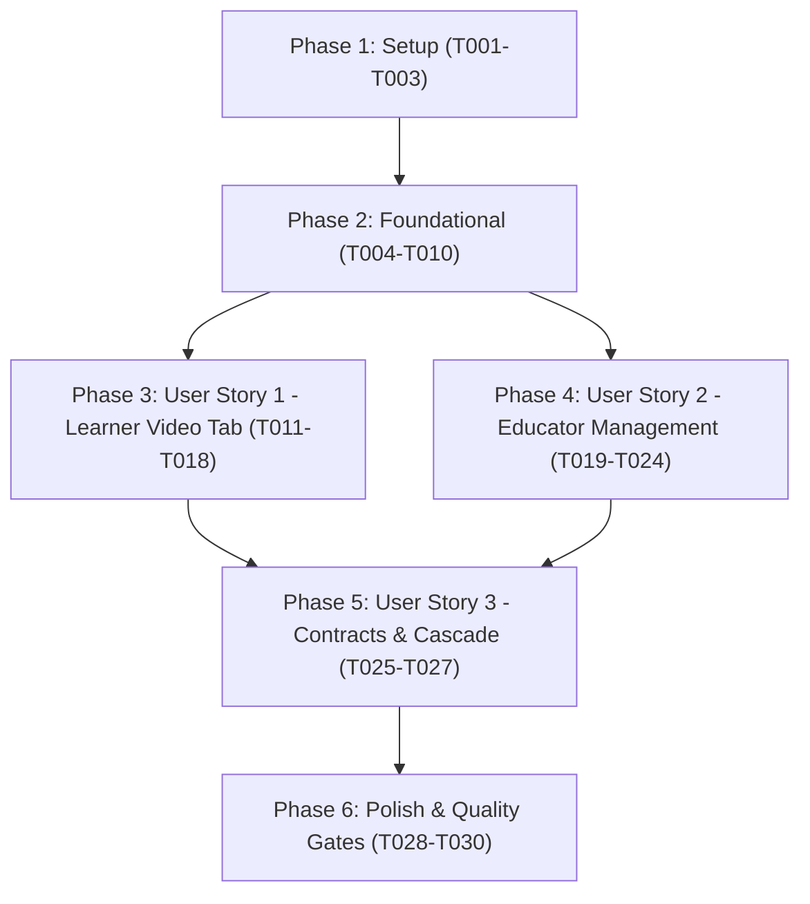

# Tasks: Lesson YouTube Reference Videos

**Branch**: `011-lesson-youtube-videos` | **Date**: 2026-11-01 | **Spec**: [spec.md](spec.md) | **Plan**: [plan.md](plan.md)

**Input**: Design documents from `/specs/011-lesson-youtube-videos/` (`spec.md`, `plan.md`, `research.md`, `data-model.md`, `contracts/lesson-videos-api.yaml`, `quickstart.md`)

---

## Phase 1: Setup (Shared Infrastructure)

**Purpose**: Core YouTube parsing utility and test foundation shared across backend and frontend

- [x] T001 Implement YouTube URL and timestamp parser utility in `apps/api/app/core/youtube.py` extracting `youtube_video_id` (11 characters) and normalizing start parameters (`t=3179s`, `52m59s`, `1h2m3s`, `3179`) to integer `start_seconds`
- [x] T002 [P] Implement frontend YouTube utility in `apps/web/features/lessons/lib/youtube.ts` with URL parser, ID extractor, and embed URL generator (`https://www.youtube-nocookie.com/embed/{id}?start={start}&rel=0`)
- [x] T003 [P] Create unit test suite for YouTube URL parser in `apps/api/test/test_youtube_parser.py` validating various YouTube formats (standard, short youtu.be, embed, live, mobile) and timestamp formats

---

## Phase 2: Foundational (Blocking Prerequisites)

**Purpose**: Database schema, persistence models, domain entities, repositories, and API schemas required before user story implementation

**⚠️ CRITICAL**: No user story work can begin until this phase is complete

- [x] T004 Create domain entity `LessonVideoEntity` in `apps/api/app/domain/entities/lesson_video.py` and repository interface `ILessonVideoRepository` in `apps/api/app/domain/interfaces/lesson_video_repo.py`
- [x] T005 [P] Create SQLModel persistence model `LessonVideo` in `apps/api/app/infrastructure/persistence/models/lesson_video.py` with foreign key `lesson_id` referencing `lessons.id` (`ondelete="CASCADE"`)
- [x] T006 Generate and apply Alembic migration for table `lesson_videos` in `apps/api/alembic/versions/` with columns: `id` (pgUUID PK), `lesson_id` (UUID FK index), `title` (VARCHAR 255), `url` (TEXT), `youtube_video_id` (VARCHAR 32), `start_seconds` (INTEGER default 0), `order` (INTEGER default 0), `description` (TEXT default ""), `created_at` (TIMESTAMP), `updated_at` (TIMESTAMP)
- [x] T007 [P] Implement `LessonVideoRepository` in `apps/api/app/infrastructure/repositories/lesson_videos.py` implementing `list_by_lesson_id`, `replace_lesson_videos`, `create`, and `delete`
- [x] T008 [P] Define Pydantic schemas in `apps/api/app/presentation/schemas/lessons.py`: `LessonVideoCreate`, `LessonVideoUpdate`, `LessonVideoOut`, `LessonVideoBatchSync`, and update `LessonDetailOut` with `videos: list[LessonVideoOut] = []`
- [x] T009 Register `ILessonVideoRepository` and related use cases in Dishka DI container in `apps/api/app/infrastructure/di/container.py`
- [x] T010 [P] Define TypeScript and Zod schemas for `LessonVideo` and `LessonVideoInput` in `apps/web/features/lessons/types.ts` and update `LessonSchema` with `videos: z.array(LessonVideoSchema).optional().default([])`

**Checkpoint**: Foundation ready - backend repository, database table, and frontend schemas in place

---

## Phase 3: User Story 1 - Learner Views Reference Videos on Dedicated Tab (Priority: P1) 🎯 MVP

**Goal**: Learners can navigate to `/lessons/[slug]/video` via the "Video" tab in `LessonTabsBar`, watch embedded 16:9 YouTube reference videos with start timestamps, toggle between videos in a playlist, and see a friendly empty state if no videos exist.

**Independent Test**: Navigate to `http://localhost:3000/lessons/ham-so/video` (with test data attached to `ham-so`), verify the "Video" tab is highlighted, the YouTube iframe player starts at the designated timestamp (e.g. `start=3179`), and clicking other playlist items smoothly switches the video player.

### Tests for User Story 1 ⚠️

- [x] T011 [P] [US1] Add use case unit test in `apps/api/test/test_lesson_videos.py` verifying that `GetLessonBySlugUseCase` returns serialized `videos` sorted by `order ASC, created_at ASC`

### Implementation for User Story 1

- [x] T012 [P] [US1] Update `GetLessonBySlugUseCase` in `apps/api/app/application/use_cases/lessons/get_lesson_by_slug_uc.py` and `GetLessonDetailUseCase` in `apps/api/app/application/use_cases/lessons/get_lesson_detail_uc.py` to retrieve videos via `ILessonVideoRepository.list_by_lesson_id`
- [x] T013 [P] [US1] Implement responsive 16:9 YouTube iframe component `YouTubePlayer` in `apps/web/features/lessons/components/video/youtube-player.tsx` with `youtube-nocookie.com` embed, start timestamp offset, and title bar
- [x] T014 [P] [US1] Implement playlist selector component `VideoPlaylist` in `apps/web/features/lessons/components/video/video-playlist.tsx` displaying thumbnail previews (`img.youtube.com/vi/{id}/hqdefault.jpg`), titles, start timestamps, and active item indicators
- [x] T015 [US1] Implement `LessonVideoTab` container component in `apps/web/features/lessons/components/video/lesson-video-tab.tsx` integrating `YouTubePlayer`, `VideoPlaylist`, video notes/descriptions, and empty state ("Chưa có video tham khảo cho bài học này")
- [x] T016 [US1] Update `LessonTabsBar` in `apps/web/features/lessons/components/lesson-tabs-bar.tsx` to include the "Video" tab (icon: `Video` from `lucide-react`, label: "Video", href: `${basePath}/video${querySuffix}`)
- [x] T017 [US1] Create page component in `apps/web/app/(root)/lessons/[slug]/(tabs)/video/page.tsx` connecting to `useLessonContext()` and rendering `LessonVideoTab`
- [x] T018 [P] [US1] Export video components from `apps/web/features/lessons/components/index.ts`

**Checkpoint**: User Story 1 (MVP) is fully functional and independently testable at `http://localhost:3000/lessons/[slug]/video`

---

## Phase 4: User Story 2 - Educator Manages YouTube Videos in Lesson Management (Priority: P2)

**Goal**: Teachers can add, preview, edit, reorder, and remove YouTube reference videos in lesson management (`LessonEditorPage` / `LessonFormModal`), persisting changes atomically to the database.

**Independent Test**: Open `/teacher/lessons/[id]/edit`, navigate to the reference video management section, add `https://www.youtube.com/watch?v=Zf-VMEgCxGE&t=3179s` with a title, verify instant thumbnail preview, save the lesson, and confirm the video persists and appears in the student tab.

### Tests for User Story 2 ⚠️

- [x] T019 [P] [US2] Add unit test in `apps/api/test/test_lesson_videos.py` verifying `SyncLessonVideosUseCase` parses URLs, sets start seconds, updates order, and handles empty video lists

### Implementation for User Story 2

- [x] T020 [US2] Implement `SyncLessonVideosUseCase` in `apps/api/app/application/use_cases/lessons/sync_lesson_videos_uc.py` to validate URLs, extract video IDs and timestamps, and sync the video list for a lesson via `ILessonVideoRepository`
- [x] T021 [P] [US2] Add endpoints `GET /api/v1/lessons/{lesson_id}/videos` and `PUT /api/v1/lessons/{lesson_id}/videos` in `apps/api/app/presentation/api/routers/lessons.py` protected by `SystemPermission.MANAGE_LESSON`
- [x] T022 [P] [US2] Add `useUpdateLessonVideos` mutation hook in `apps/web/features/lessons/queries.ts` invalidating `["lessons"]` and `["lessons", "by-slug"]` queries on success
- [x] T023 [US2] Implement `LessonVideoFormSection` component in `apps/web/features/lessons/components/video/lesson-video-form-section.tsx` supporting URL input, real-time thumbnail preview, title input, reordering items, and removal
- [x] T024 [US2] Integrate `LessonVideoFormSection` into `LessonEditorPage` in `apps/web/features/lessons/components/lesson-editor-page.tsx` and modal form `LessonForm` in `apps/web/features/lessons/components/lesson-form.tsx`

**Checkpoint**: User Story 2 complete - teachers can manage video playlists with instant preview and order control

---

## Phase 5: User Story 3 - API Contracts & Domain Persistence for Lesson Videos (Priority: P3)

**Goal**: Full API contract synchronization, strict type safety between backend and frontend, and verification of database cascades.

**Independent Test**: Run `make generate-api` and verify `apps/web/types/api.generated.d.ts` matches backend response types without drift. Verify deleting a lesson drops attached videos via foreign key cascade.

### Tests for User Story 3 ⚠️

- [x] T025 [P] [US3] Add unit test in `apps/api/test/test_lesson_videos.py` verifying foreign key cascade: deleting a lesson automatically removes all attached `lesson_videos` rows

### Implementation for User Story 3

- [x] T026 [US3] Run `make generate-api` to synchronize FastAPI OpenAPI specification into `apps/web/types/api.generated.d.ts`
- [x] T027 [P] [US3] Verify and refine error responses in `apps/api/app/core/youtube.py` to return clear Vietnamese validation errors (`"Đường dẫn video phải là link YouTube hợp lệ"`) when invalid URLs are submitted

**Checkpoint**: Full contract synchronization achieved, cascade deletion verified, and API boundary secured

---

## Phase 6: Polish & Cross-Cutting Concerns

**Purpose**: Code cleanup, automated linting, type-checking, and full regression verification

- [x] T028 [P] Run Python linting and formatting via `uv run ruff check apps/api` and `uv run ruff format --check apps/api`
- [x] T029 [P] Run frontend typecheck and linting via `npm run type-check` and `npm run lint` in `apps/web`
- [x] T030 Execute full end-to-end verification scenario per `specs/011-lesson-youtube-videos/quickstart.md` and run root quality suite `make check`

---

## Dependencies & Execution Order

### Phase Dependencies

- **Setup (Phase 1)**: Can start immediately (pure utilities and parser tests).
- **Foundational (Phase 2)**: Depends on Phase 1 completion - **BLOCKS** all user stories.
- **User Story 1 (Phase 3 - MVP)**: Depends on Phase 2 completion. Can be deployed/tested independently.
- **User Story 2 (Phase 4)**: Depends on Phase 2 completion. Can be developed in parallel with US1.
- **User Story 3 (Phase 5)**: Depends on US1 & US2 backend endpoints being defined.
- **Polish (Phase 6)**: Depends on all user stories being complete.

---

## Parallel Opportunities

- **Phase 1**: `T002` (Frontend parser) and `T003` (Backend parser tests) can run in parallel with `T001`.
- **Phase 2**: `T005` (SQLModel), `T007` (Repo), `T008` (Schemas), and `T010` (Frontend types) can run in parallel after `T004`.
- **Phase 3 (US1)**: `T011` (Backend test), `T013` (Player UI), and `T014` (Playlist UI) can run in parallel.
- **Phase 4 (US2)**: `T019` (Test), `T021` (API endpoints), and `T022` (Query hook) can run in parallel.
- **Phase 6**: `T028` (Python lint) and `T029` (Frontend typecheck) can run in parallel.

---

## Implementation Strategy

### MVP First (User Story 1 Focus)

1. Complete **Phase 1** (YouTube parser utility)
2. Complete **Phase 2** (Database migration, models, schemas)
3. Complete **Phase 3** (Learner route `/lessons/[slug]/video` & tabs bar)
4. **VALIDATE MVP**: Verify learners can watch YouTube videos on `http://localhost:3000/lessons/ham-so/video`
5. Proceed with **Phase 4** (Educator management UI), **Phase 5** (API contract sync), and **Phase 6** (Quality gates)
