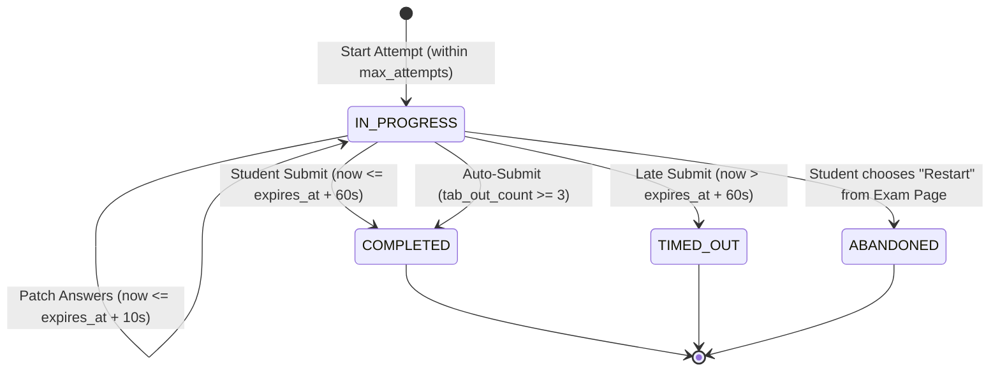

# Data Model & Domain Design: Exam Attempt Lifecycle & Scoring

**Feature**: `014-exam-attempt-lifecycle`  
**Date**: 2026-11-07  
**Status**: Completed  

## 1. Domain Entities & Value Objects

### 1.1 `AttemptStatus` (Enum)

```python
class AttemptStatus(StrEnum):
    IN_PROGRESS = "IN_PROGRESS"
    COMPLETED = "COMPLETED"
    TIMED_OUT = "TIMED_OUT"      # Finalized after grace period expiration
    ABANDONED = "ABANDONED"      # Replaced by student choosing to restart
```

### 1.2 `AttemptEntity`

```python
@dataclasses.dataclass
class AttemptEntity:
    id: UUID
    exam_id: UUID
    user_id: int
    started_at: datetime
    completed_at: datetime | None
    expires_at: datetime
    score: float | None                   # Thang 10 (0.00 to 10.00, rounded 2 decimal places)
    correct_count: int | None             # Raw count of correct questions (e.g. 16)
    total_questions: int | None           # Total question count in attempt (e.g. 20)
    status: AttemptStatus
    tab_out_count: int
    shuffle_seed: int | None
    shuffle_snapshot: ShuffledSnapshot | None

    def is_expired(self, grace_seconds: int = 0) -> bool:
        return now_ict() > (self.expires_at + timedelta(seconds=grace_seconds))

    def score_attempt(
        self,
        questions: list[QuestionEntity],
        answers_by_question_id: dict[UUID, str | None],
    ) -> tuple[float, int, int]:
        """
        Calculates score on 10-point scale along with raw correct and total counts.
        Returns: (score_10, correct_count, total_questions)
        """
        n = len(questions)
        if n == 0:
            return 0.0, 0, 0
        
        per = 10.0 / n
        correct = 0
        for q in questions:
            sel = answers_by_question_id.get(q.id)
            if sel is None:
                continue
            for opt in q.options:
                if opt.id == sel and opt.is_correct:
                    correct += 1
                    break

        total = round(min(correct * per, 10.0), 2)
        return total, correct, n
```

### 1.3 `ExamEntity` Access & Attempt Policy Correction

```python
@dataclasses.dataclass
class ExamEntity:
    # ... existing fields ...
    
    def can_access(self, user_id: int | None) -> bool:
        """Kiểm tra quyền truy cập bài thi."""
        if self.access_scope == ExamAccessScope.PUBLIC:
            return True
        # Restricted access MUST require an authenticated user
        if user_id is None:
            return False
        if user_id == self.created_by:
            return True
        return bool(self.participant_ids and user_id in self.participant_ids)
```

---

## 2. In-Memory Calculation (No DB Migration Required)

`correct_count` and `total_questions` are computed dynamically **in-memory** within `AttemptEntity.score_attempt` and `ReviewAttemptUseCase.execute()`. They are exposed via the Pydantic schema `AttemptOut` without requiring schema alters or migrations in PostgreSQL:

- When `SubmitAttemptUseCase` runs: `att.score_attempt(questions, answers)` calculates `correct_count` and `total_questions` in memory on the `AttemptEntity`. The router serializes them via `AttemptOut.model_validate(att)`.
- When `ReviewAttemptUseCase` runs: In-memory evaluation parses `questions` and `answers`, setting `correct_count` and `total_questions` so `AttemptOut` is fully populated.
- Frontend types generated via `make generate-api` (`npm run generate:api`) synchronize these fields directly into `types/api.generated.d.ts`.

---

## 3. Repository Interface Contracts

### 3.1 `IAttemptRepository`

```python
class IAttemptRepository(ABC):
    @abstractmethod
    async def get_active_for_user_exam(
        self, user_id: int, exam_id: UUID
    ) -> AttemptEntity | None:
        """Find an attempt that is IN_PROGRESS and not expired."""
        pass

    @abstractmethod
    async def count_completed_or_active_for_user_exam(
        self, user_id: int, exam_id: UUID
    ) -> int:
        """Count attempts that consume the user's quota (COMPLETED, TIMED_OUT, ABANDONED)."""
        pass
```

### 3.2 `IQuestionRepository` (Bulk Query to eliminate N+1)

```python
class IQuestionRepository(ABC):
    @abstractmethod
    async def get_by_ids(self, question_ids: list[UUID]) -> list[QuestionEntity]:
        """Fetch multiple questions in a single database roundtrip."""
        pass
```

---

## 4. Attempt Lifecycle State Machine


