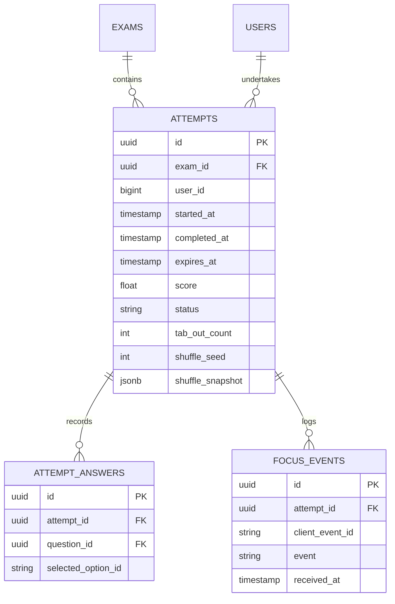

# Data Model: Manage Student Exam Attempts

**Feature**: `015-manage-exam-attempts`  
**Date**: 2026-11-07  
**Status**: Completed  

---

## Existing Entities & Schema Relationships

---

## Deletion Cascading Rules

When an attempt is deleted via `IAttemptRepository.delete(attempt_id: UUID)`:
1. Delete all `attempt_answers` where `attempt_id == :attempt_id`.
2. Delete all `focus_events` where `attempt_id == :attempt_id`.
3. Delete the `attempt` where `id == :attempt_id`.
4. Wrap all three operations in a single atomic database transaction.

---

## Presentation DTO Models

### 1. `StudentAttemptQuestionDetail`
Represents an individual question in the teacher review screen:
* `id` (`UUID`): Canonical question ID.
* `content` (`str`): Question content text/markdown.
* `options` (`list[QuestionOptionOut]`): List of options in presentation order.
* `selected_option_id` (`str | None`): Option ID selected by the student (or null if unanswered).
* `correct_option_id` (`str | None`): The designated correct option ID.
* `is_correct` (`bool | None`): True if correct, False if wrong, None if left blank.

### 2. `StudentAttemptFocusEventOut`
* `id` (`UUID`): Focus event ID.
* `event` (`str`): Event name (`mouse_leave`, `window_blur`, `timer_throttled`, etc.).
* `received_at` (`datetime`): Event timestamp in ICT.

### 3. `StudentAttemptDetailOut`
* `id` (`UUID`): Attempt ID.
* `exam_id` (`UUID`): Exam ID.
* `user_id` (`int`): Student ID.
* `status` (`str`): `IN_PROGRESS` | `COMPLETED` | `ABANDONED`.
* `score` (`float | None`): Score on 10-point scale (or None if incomplete).
* `tab_out_count` (`int`): Cumulative violation count.
* `started_at` (`datetime`): Test start timestamp.
* `completed_at` (`datetime | None`): Test submission timestamp.
* `expires_at` (`datetime`): Test deadline timestamp.
* `questions` (`list[StudentAttemptQuestionDetail]`): Question breakdown.
* `focus_events` (`list[StudentAttemptFocusEventOut]`): Chronological event log.

### 4. `StudentExamAttemptsResponse`
* `student_id` (`int`): Student ID.
* `exam_id` (`UUID`): Exam ID.
* `attempts` (`list[StudentAttemptDetailOut]`): All attempts sorted by `started_at DESC`.
* `total_attempts` (`int`): Number of attempts.
* `best_score` (`float | None`): Highest completed score.
* `max_tab_out` (`int`): Maximum tab-out count across all attempts.

### 5. `DeleteAttemptResponse`
* `success` (`bool`): True.
* `message` (`str`): Confirmation message.
* `deleted_attempt_id` (`UUID`): The deleted attempt ID.
