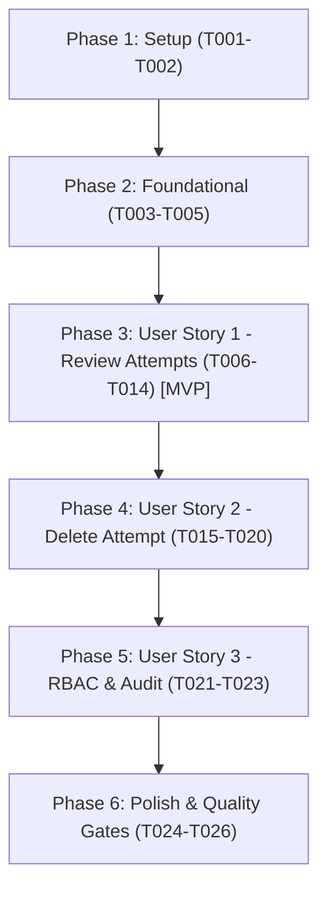

# Tasks: Teacher View Attempt Details & Delete/Reset Attempt

**Input**: Design documents from `/specs/015-manage-exam-attempts/`  
**Prerequisites**: `plan.md`, `spec.md`, `research.md`, `data-model.md`, `contracts/student-attempts-api.yaml`, `quickstart.md`  
**Organization**: Tasks are grouped by user story to enable independent implementation and testing of each story.

---

## Format: `[ID] [P?] [Story] Description`

- **[P]**: Can run in parallel (different files, no dependencies)
- **[Story]**: Which user story this task belongs to (`US1`, `US2`, `US3`)
- Includes exact file paths in every task description

---

## Phase 1: Setup (Shared Infrastructure)

**Purpose**: Project schemas, DTOs, and interface definitions

- [ ] T001 Define presentation schemas and DTOs (`StudentExamAttemptsResponse`, `StudentAttemptDetailOut`, `StudentAttemptQuestionDetail`, `DeleteAttemptResponse`) in `apps/api/app/presentation/schemas/exam_attempts.py`
- [ ] T002 [P] Export new schemas in `apps/api/app/presentation/schemas/__init__.py` and declare interface methods `delete_attempt(attempt_id: UUID)` and `list_for_user_and_exam(exam_id: UUID, user_id: int)` in `apps/api/app/domain/interfaces/attempt_repo.py`

---

## Phase 2: Foundational (Blocking Prerequisites)

**Purpose**: Core repository infrastructure that MUST be complete before user stories can execute

**⚠️ CRITICAL**: Foundational tasks must complete before implementing use cases and frontend pages

- [ ] T003 Implement atomic cascading attempt deletion (`attempt_answers`, `focus_events`, `attempts` within a single transaction) in `apps/api/app/infrastructure/repositories/attempts.py`
- [ ] T004 [P] Implement `IAttemptRepository.list_for_user_and_exam(exam_id: UUID, user_id: int)` in `apps/api/app/infrastructure/repositories/attempts.py`
- [ ] T005 [P] Register `GetStudentAttemptsUseCase` and `DeleteExamAttemptUseCase` dependencies in Dishka container in `apps/api/app/infrastructure/di/use_cases.py`

**Checkpoint**: Foundation ready - User Story 1 and User Story 2 can proceed.

---

## Phase 3: User Story 1 - Teacher Inspects Student Exam Attempts on Dedicated Page (Priority: P1) 🎯 MVP

**Goal**: An educator can click a student card on `/teacher/stats/[id]` and navigate to `/teacher/stats/[id]/students/[studentId]` to inspect all student attempts with full question-by-question breakdowns, selected options, correct answers, and anti-cheat event logs.

**Independent Test**: Navigate to `/teacher/stats/[id]/students/[studentId]`, verify that all student attempts load with questions, options, student selected choices, correctness badges, and anti-cheat event timeline.

### Tests for User Story 1 ⚠️

- [ ] T006 [P] [US1] Unit test for `GetStudentAttemptsUseCase` covering question presentation reconstruction via `shuffle_snapshot` and answer matching in `apps/api/test/test_manage_student_attempts.py`

### Implementation for User Story 1

- [ ] T007 [US1] Implement `GetStudentAttemptsUseCase` reconstructing question presentation from `shuffle_snapshot` and matching student answers in `apps/api/app/application/use_cases/exams/get_student_attempts_uc.py`
- [ ] T008 [US1] Add `GET /api/v1/exams/{exam_id}/students/{student_id}/attempts` endpoint with `EducatorUser` guard in `apps/api/app/presentation/api/routers/exams.py`
- [ ] T009 [P] [US1] Add React Query hook `useStudentExamAttempts(examId, studentId)` in `apps/web/features/exams/queries.ts` and response types in `apps/web/features/exams/types.ts`
- [ ] T010 [P] [US1] Create student header component with breadcrumb and summary badges in `apps/web/features/exams/components/exam-stats/student-attempts/student-attempt-header.tsx`
- [ ] T011 [P] [US1] Create question review cards displaying selected option vs correct option in `apps/web/features/exams/components/exam-stats/student-attempts/attempt-question-review.tsx`
- [ ] T012 [P] [US1] Create anti-cheat focus events timeline component in `apps/web/features/exams/components/exam-stats/student-attempts/attempt-focus-timeline.tsx`
- [ ] T013 [US1] Assemble dedicated student attempts review page at `apps/web/app/(root)/teacher/stats/[id]/students/[studentId]/page.tsx`
- [ ] T014 [US1] Update candidate cards in `apps/web/features/exams/components/exam-stats/participants-tab.tsx` to link to `/teacher/stats/[id]/students/[studentId]`

**Checkpoint**: User Story 1 is fully functional and delivers an independently testable MVP.

---

## Phase 4: User Story 2 - Teacher Hard Deletes an Attempt to Grant Retake (Priority: P2)

**Goal**: An educator can delete an attempt directly from the student review screen, permanently cascading removal of child answers/events, refunding the attempt slot so the student can retake the test, and automatically updating exam stats.

**Independent Test**: Click "Xóa lượt thi này" on an attempt, confirm in modal, verify attempt is hard-deleted from DB, student's used attempts counter decrements by 1, and exam stats update immediately without page reload.

### Tests for User Story 2 ⚠️

- [ ] T015 [P] [US2] Unit test for `DeleteExamAttemptUseCase` verifying cascading deletion and non-existent attempt handling in `apps/api/test/test_manage_student_attempts.py`

### Implementation for User Story 2

- [ ] T016 [US2] Implement `DeleteExamAttemptUseCase` executing atomic cascading deletion in `apps/api/app/application/use_cases/exams/delete_exam_attempt_uc.py`
- [ ] T017 [US2] Add `DELETE /api/v1/exams/{exam_id}/attempts/{attempt_id}` endpoint with `EducatorUser` guard in `apps/api/app/presentation/api/routers/exams.py`
- [ ] T018 [P] [US2] Add React Query mutation hook `useDeleteExamAttempt(examId, studentId)` with cache invalidation for `["exam-stats", examId]` and `["student-attempts", examId, studentId]` in `apps/web/features/exams/queries.ts`
- [ ] T019 [US2] Implement delete confirmation modal dialog component in `apps/web/features/exams/components/exam-stats/student-attempts/delete-attempt-dialog.tsx`
- [ ] T020 [US2] Integrate delete button and confirmation modal into attempt cards in `apps/web/app/(root)/teacher/stats/[id]/students/[studentId]/page.tsx`

**Checkpoint**: User Story 2 is complete. Teachers can delete attempts to grant retakes.

---

## Phase 5: User Story 3 - Role-Based Access Control & Action Auditing (Priority: P3)

**Goal**: Enforce strict RBAC so only educators/admins can access student answer sheets or delete attempts, and record structured audit logs for deletions.

**Independent Test**: Send GET and DELETE requests as a regular student or unauthenticated user and verify 403 Forbidden is returned.

### Implementation for User Story 3

- [ ] T021 [US3] Add exam ownership/educator permission validation helper in `apps/api/app/application/use_cases/exams/delete_exam_attempt_uc.py` and `get_student_attempts_uc.py`
- [ ] T022 [US3] Add structured audit logging (educator ID, student ID, deleted attempt ID, timestamp) on deletion in `apps/api/app/application/use_cases/exams/delete_exam_attempt_uc.py`
- [ ] T023 [P] [US3] Add test case for 403 Forbidden rejection when non-educators call student attempt endpoints in `apps/api/test/test_manage_student_attempts.py`

**Checkpoint**: All user stories are implemented, verified, and secured.

---

## Phase 6: Polish & Cross-Cutting Concerns

**Purpose**: Verification, quality gates, and end-to-end testing

- [ ] T024 [P] Run backend pytest suite `uv run pytest apps/api/test/test_manage_student_attempts.py -v`
- [ ] T025 [P] Run frontend TypeScript type-check `npm run --prefix apps/web type-check`
- [ ] T026 Execute manual end-to-end verification following `quickstart.md` scenarios

---

## Dependencies & Execution Order

### Phase Dependencies

### Parallel Opportunities

- **Phase 1**: T001 and T002 can be implemented in parallel.
- **Phase 2**: T004 and T005 can run in parallel with T003.
- **Phase 3**: Frontend UI components (T010, T011, T012) can be built in parallel with backend use case (T007) and test (T006).
- **Phase 4**: Delete hook (T018) and delete modal (T019) can be built in parallel with backend use case (T016) and test (T015).
- **Phase 6**: T024 (Pytest) and T025 (TypeScript typecheck) can run in parallel.

---

## Implementation Strategy

### MVP First (User Story 1 Only)
1. Complete Setup (T001-T002) + Foundational (T003-T005).
2. Complete User Story 1 (T006-T014).
3. **Validate MVP**: Teachers can click any student card and inspect the full attempt and question breakdown on the dedicated page `/teacher/stats/[id]/students/[studentId]`.

### Incremental Delivery (User Story 2 & 3)
1. Implement User Story 2 (T015-T020): Adds the "Xóa lượt thi này" button with confirmation modal and atomic cascading delete.
2. Implement User Story 3 (T021-T023): Hardens RBAC and audit logging.
3. Complete Polish (T024-T026): Pytest suite + TypeScript verification.
