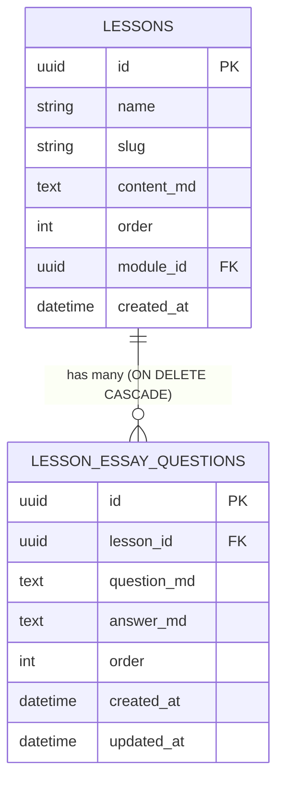

# Data Model: Lesson Essay Questions & Reference Answers

**Feature**: `018-lesson-essay-questions`  
**Date**: 2026-11-18  
**Spec**: [spec.md](spec.md)

---

## Entity-Relationship Overview



---

## Database Schema (`lesson_essay_questions`)

| Column | Type | Constraints | Default | Description |
| --- | --- | --- | --- | --- |
| `id` | `UUID` | `PRIMARY KEY`, `NOT NULL` | `uuid4()` | Canonical unique identifier for the essay question |
| `lesson_id` | `UUID` | `FOREIGN KEY (lessons.id) ON DELETE CASCADE`, `NOT NULL`, `INDEX` | — | Owning lesson identifier; deleting the lesson cascades deletion |
| `question_md` | `TEXT` | `NOT NULL` | — | Open-ended question prompt stored as Markdown text |
| `answer_md` | `TEXT` | `NOT NULL` | — | Reference answer stored as Markdown text |
| `order` | `INTEGER` | `NOT NULL` | `0` | Non-negative display sequence index (`0, 1, 2, ...`) |
| `created_at` | `TIMESTAMP` | `NOT NULL` | `now_ict()` | Creation timestamp (ICT, consistent with `LessonVideo`) |
| `updated_at` | `TIMESTAMP` | `NOT NULL` | `now_ict()` | Last modification timestamp (auto-updated on write) |

### Indexes & Constraints

- **Primary Key**: `pk_lesson_essay_questions (id)`
- **Foreign Key**: `fk_lesson_essay_questions_lesson_id` -> `lessons.id` with `ON DELETE CASCADE`
- **Index**: `ix_lesson_essay_questions_lesson_id` on `(lesson_id)` — supports fast ordered lookup by lesson (`WHERE lesson_id = ? ORDER BY order ASC, created_at ASC`).

---

## Domain Layer (`apps/api/app/domain/`)

### `LessonEssayQuestionEntity` (`domain/entities/lesson_essay_question.py`)

```python
@dataclass
class LessonEssayQuestionEntity:
    id: UUID
    lesson_id: UUID
    question_md: str
    answer_md: str
    order: int = 0
    created_at: datetime | None = None
    updated_at: datetime | None = None
```

### `ILessonEssayQuestionRepository` (`domain/interfaces/lesson_essay_question_repo.py`)

- `list_by_lesson_id(lesson_id: UUID) -> list[LessonEssayQuestionEntity]`
  - Returns all essay questions for `lesson_id` sorted by `order ASC, created_at ASC`.
- `replace_lesson_essay_questions(lesson_id: UUID, items: list[LessonEssayQuestionEntity]) -> list[LessonEssayQuestionEntity]`
  - Atomically synchronizes all essay questions for `lesson_id` within the active transaction: deletes removed items, updates existing items matching `id` (preserving `created_at` and updating `updated_at`), and inserts new items. Returns the saved list sorted by `order ASC, created_at ASC`.

---

## API Schemas (`apps/api/app/presentation/schemas/lessons.py`)

### `LessonEssayQuestionCreate` (Request Item)

| Field | Type | Validation Rules |
| --- | --- | --- |
| `id` | `UUID \| None` | Optional; if provided and belongs to the lesson, preserved during sync |
| `question_md` | `str` | Required; validator strips whitespace check — MUST contain non-whitespace characters (`len(v.strip()) > 0`), otherwise HTTP 422 |
| `answer_md` | `str` | Required; validator strips whitespace check — MUST contain non-whitespace characters (`len(v.strip()) > 0`), otherwise HTTP 422 |
| `order` | `int` | Optional, default `0`, `ge=0`; normalized sequentially (`0..N-1`) if omitted or colliding |

*Note*: Preserve internal Markdown indentation and leading/trailing spaces inside code blocks when storing; trim only leading/trailing outer whitespace or store trimmed content cleanly (`question_md.strip()`, `answer_md.strip()`).

### `LessonEssayQuestionBatchSync` (Request Body)

| Field | Type | Default |
| --- | --- | --- |
| `essay_questions` | `list[LessonEssayQuestionCreate]` | `[]` |

### `LessonEssayQuestionOut` (Response Item)

| Field | Type | Notes |
| --- | --- | --- |
| `id` | `UUID` | Canonical entity identifier |
| `lesson_id` | `UUID` | Parent lesson UUID |
| `question_md` | `str` | Markdown prompt |
| `answer_md` | `str` | Markdown reference answer |
| `order` | `int` | Display order |
| `created_at` | `datetime` | Creation timestamp |
| `updated_at` | `datetime` | Last update timestamp |

### `LessonDetailOut` (Extended)

- Adds `essay_questions: list[LessonEssayQuestionOut] = []` alongside existing `videos: list[LessonVideoOut] = []`.

---

## Frontend Types & State (`apps/web/features/lessons/`)

### Contract-Derived Types (Constitution Principle II)

- `LessonEssayQuestion = Schema<"LessonEssayQuestionOut">`
- `LessonEssayQuestionCreate = Schema<"LessonEssayQuestionCreate">`
- `LessonDetail = Schema<"LessonDetailOut">`

### Form Validation Schema (Untrusted Educator Form Input Only)

- `LessonEssayQuestionDraftSchema` (Zod): validates that `question_md.trim().length > 0` ("Nội dung câu hỏi không được để trống") and `answer_md.trim().length > 0` ("Nội dung đáp án không được để trống").

### Client Ephemeral UI State (Learner View)

- `revealedIds: Set<string>` — initialized as `new Set()` on mount.
  - Toggle single question: adds/removes `question.id` in `revealedIds`.
  - "Hiện tất cả đáp án": sets `revealedIds` to `new Set(questions.map(q => q.id))`.
  - "Ẩn tất cả đáp án": resets `revealedIds` to `new Set()`.
  - Resets automatically on route unmount / lesson change (satisfies SC-002 and spec Assumptions).
